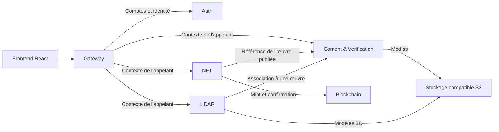

# Cahier des charges technique — Service NFT « Preserving the Art »

> **Destinataire** : l'agent IA de développement chargé de concevoir, implémenter et tester le service NFT.
> **Statut** : spécification validée. Implémentation non commencée. Les écarts avec l'architecture du projet (§4.0.4) restent à arbitrer avant le lot L0.
> **Rôle du document** : source de vérité unique pour le contexte, les décisions, les interfaces, l'implémentation et les tests du service NFT. Pour ce qui ne concerne que le service NFT, ce document prévaut sur toute autre source. Pour ce qui touche plusieurs services ou l'architecture globale, les règles du projet prévalent (§0.3) : tout conflit est signalé, puis arbitré avec les propriétaires concernés. S'il est lui-même incohérent, l'agent s'arrête et demande.

---

## Sommaire

0. [Mode d'emploi pour l'agent IA](#0-mode-demploi-pour-lagent-ia)
1. [Contexte et objectifs](#1-contexte-et-objectifs)
2. [Périmètre et responsabilités](#2-périmètre-et-responsabilités)
3. [Décisions figées](#3-décisions-figées)
4. [Architecture](#4-architecture)
5. [Stack technique](#5-stack-technique)
6. [Exigences non fonctionnelles](#6-exigences-non-fonctionnelles)
7. [Contrat d'interface](#7-contrat-dinterface)
8. [Smart contract `PreservingArt`](#8-smart-contract-preservingart)
9. [Conception du service `nft-service`](#9-conception-du-service-nft-service)
10. [Exigences envers les autres services](#10-exigences-envers-les-autres-services)
11. [Anti-patterns interdits](#11-anti-patterns-interdits)
12. [Plan d'implémentation](#12-plan-dimplémentation)
13. [Stratégie de tests](#13-stratégie-de-tests)
14. [Definition of Done](#14-definition-of-done)
15. [Démo et vérification du rendu](#15-démo-et-vérification-du-rendu)
16. [Risques](#16-risques)
17. [Hypothèses, questions ouvertes et journal des décisions](#17-hypothèses-questions-ouvertes-et-journal-des-décisions)
18. [Glossaire du projet](#18-glossaire-du-projet)
- [Annexe A — `.env.example`](#annexe-a--envexample)
- [Annexe B — Extrait `docker-compose.yml`](#annexe-b--extrait-docker-composeyml)

---

## 0. Mode d'emploi pour l'agent IA

### 0.1 Conventions de lecture

| Mot-clé | Sens |
|---|---|
| **DOIT** / **NE DOIT PAS** | Obligatoire. Aucune exception sans validation humaine explicite. |
| **DEVRAIT** / **NE DEVRAIT PAS** | Recommandé. Tout écart est justifié dans le journal des décisions (§17.3). |
| **PEUT** | Optionnel. |
| **[À VÉRIFIER]** | Dépend d'une documentation externe qui a pu évoluer. Consulter la documentation officielle à jour avant d'implémenter, puis mettre ce document à jour. |
| **[HUMAIN]** | Action réservée à un humain : l'agent la prépare et l'explique, mais ne l'exécute pas lui-même. |

### 0.2 Règles de conduite

1. **Lire ce document en entier** avant toute modification du dépôt.
2. **Décisions figées.** Les décisions du §3 et le contrat d'interface du §7 NE DOIVENT PAS être modifiés sans accord explicite de la personne responsable du service. En cas d'incohérence ou de blocage, l'agent DOIT s'arrêter, exposer le problème et proposer des options chiffrées.
3. **Périmètre d'écriture** : `services/nft-service/` et `packages/nft-contracts/`. Les autres services appartiennent à d'autres équipes : l'agent PEUT proposer du code pour eux (extraits, diffs), mais NE DOIT PAS les modifier.
4. **Travail par lots** (§12), dans l'ordre des dépendances. Un lot est terminé uniquement quand tous ses critères d'acceptation sont remplis et que les tests passent.
5. **Accord humain obligatoire avant chaque exécution** des actions irréversibles ou coûteuses :
   - déploiement du contrat sur Fuji ;
   - tout mint sur Fuji ;
   - envoi de fichiers réels sur Pinata ;
   - toute opération qui consomme des AVAX.
6. **Secrets.**
   - Ils NE DOIVENT figurer que dans `.env`, créé par un humain.
   - Ils NE DOIVENT PAS être commités, ni apparaître dans les logs, les tests, les messages d'erreur, les fixtures ou ce document.
7. **Dépendances.** Seules celles du §5.3 sont autorisées. Toute autre DOIT être justifiée dans le journal (§17.3).
8. **Ce document est vivant.** L'agent DOIT le mettre à jour quand il prend une décision, résout un point [À VÉRIFIER] ou constate un écart.
9. **Pédagogie.** La personne responsable du service débute en blockchain. L'agent DOIT expliquer brièvement chaque choix technique en français, en renvoyant si besoin à `blockchain_notion.md` (s'il est présent dans le dépôt).
10. **Langues.**
    - Code, identifiants, commentaires, logs et messages d'erreur techniques : **anglais**.
    - Documentation et échanges avec l'équipe : **français**.
    - Les libellés publiés dans les fiches NFT (attributs) : **français**.

### 0.3 Règles communes du projet

Le service NFT fait partie du dépôt LOVA. Ces règles s'ajoutent à celles du §0.2. Sources : [AGENTS.md](../../../AGENTS.md), [politique de code](../../../docs/development/code-policy.md), [guide CI](../../../docs/development/ci.md) et [CONTRIBUTING.md](../../../CONTRIBUTING.md).

1. **Protocole de session.** Commencer par lire `AGENTS.md`, le [handoff](../../../docs/agents/handoff.md), puis les tâches NFT du [backlog](../../../docs/product/task.md). Terminer en ajoutant une ligne au [journal de session](../../../docs/agents/log.md), sans réécrire les lignes existantes, puis en mettant le handoff à jour.
2. **Qui décide.**
   - salandri-42 décide dans le périmètre NFT, y compris les décisions projet D08 à D11 (§4.0.3).
   - Un contrat ou une dépendance entre services s'accorde avec le propriétaire concerné.
   - Tout changement du MVP ou de l'architecture globale passe par endy-rkt.
3. **Accord préalable d'endy-rkt** pour :
   - toute nouvelle dépendance, y compris celles du §5.3 ;
   - les configs racine : `eslint.config.mjs`, `.prettierrc.json`, `.prettierignore`, `.editorconfig`, `tsconfig.base.json` ;
   - `.github/workflows/**` et `.github/dependabot.yml` ;
   - le Taskfile et le déploiement.
4. **Livrables du propriétaire.** Le service livre ses tests unitaires et d'intégration, son `Dockerfile` et son `.dockerignore` dans `apps/backend/nft/`, et son entrée dans le `docker-compose.yml` racine. Les ressources partagées du Compose (base, stockage, Redis éventuel) se coordonnent avec leurs propriétaires.
5. **Qualité.**
   - Les configs racine s'appliquent : ESLint strict avec typage, Prettier via `.prettierrc.json`, et un `tsconfig.json` du service qui étend `tsconfig.base.json`.
   - Le lint et le formatage se lancent depuis la racine.
   - Le workspace définit les scripts `typecheck`, `test` et `build`, exigés par la CI. `ci-ok` est le seul check requis.
   - Un check indisponible est signalé « not runnable yet ».
6. **Frontières.** Aucun import du code source d'une autre application. Les services communiquent par contrat. `packages/shared` ne s'importe qu'en `import type` (D14).
7. **Git.** Les branches partent de `develop` (`feature/`, `fix/`, `docs/`, `chore/`). Les PR visent `develop` et exigent `ci-ok` vert et une revue.
8. **Dépôt public.** Aucun secret commité. Les médias culturels restent hors de Git tant que D18 n'est pas tranchée. Les fixtures sont synthétiques ou sous licence vérifiée.
9. **Langue.** La documentation du dépôt est en anglais, seul le sous-titre du README fait exception. Ce document, rédigé en français, constitue l'écart E12 (§4.0.4), à régler avant de le commiter.
10. **Chemins.** Ce document suit une arborescence `services/*` qui n'existe pas dans le dépôt. Appliquer la correspondance du §4.0.3.

---

## 1. Contexte et objectifs

### 1.1 Le projet

**LOVA** (« patrimoine » en malgache) est un musée numérique immersif et participatif dédié au patrimoine culturel de Madagascar. Il est réalisé pour un **hackathon** dont le thème est **« Preserving the Art »**. Le dépôt est en pré-implémentation : seules la documentation et les configurations communes existent. Références : [README](../../../README.md) et [MVP](../../../docs/product/MVP.md).

La démo relie trois expériences :

- **Visiter** : parcourir la galerie, zoomer sur une peinture, faire pivoter une sculpture en 3D.
- **Contribuer** : créer la fiche d'une œuvre, y joindre des photos, des vidéos ou un modèle 3D autorisé, puis la soumettre à relecture.
- **Valider et tracer** : une relecture humaine précède la publication, puis l'œuvre acceptée reçoit son NFT de provenance. Le MVP exige une intégration NFT fonctionnelle (section C du MVP).

Règles produit qui s'appliquent au service NFT :

- la relecture précède la publication et tout mint ;
- les œuvres générées par IA sont exclues de la collection ;
- le MVP exclut la vente, le transfert dans l'interface, les paiements et la marketplace.

Dans ce cadre, le service NFT certifie les œuvres d'une **galerie numérique d'œuvres traditionnelles**, de trois catégories :

| Catégorie | Code | Contenu numérisé |
|---|---|---|
| Peinture | `PAINTING` | Scan 2D haute définition |
| Sculpture | `SCULPTURE` | Scan et modèle 3D |
| Savoir-faire artisanal | `CRAFT` | Vidéo montrant la technique |

Chaque œuvre est d'abord **enregistrée dans la base de la galerie**, avec sa description et ses fichiers. Quand un curateur la **publie**, le service NFT crée son **NFT** sur la blockchain.

### 1.2 La valeur métier : un certificat de préservation

Le NFT est un **certificat numérique public, infalsifiable et permanent**. Il atteste :

- de l'existence de l'œuvre et de la date de sa certification par la galerie ;
- de sa description et de ses caractéristiques (artiste, matériau, période…), figées sur IPFS ;
- de **l'intégrité de son fichier d'archive** (« fichier maître »), dont l'empreinte sha256 est inscrite sur la blockchain.

Ce dernier point est le cœur du pitch. En conservation numérique, le **contrôle de fixité** consiste à recalculer régulièrement l'empreinte d'un fichier d'archive pour prouver qu'il n'a été ni corrompu, ni retouché, ni falsifié. Ici, l'empreinte de référence est gravée dans la blockchain : n'importe qui peut vérifier, aujourd'hui comme dans vingt ans, qu'un fichier est bien l'original numérisé par la galerie.

> **Portée de la preuve (règle confirmée du projet).** Le token documente un événement numérique : la certification, à une date donnée, d'un fichier maître et d'une fiche relue. À lui seul, il n'établit ni l'authenticité physique de l'œuvre, ni l'exactitude des affirmations, ni la propriété ou les droits d'auteur : ceux-ci reposent sur des preuves et des autorisations distinctes. Le contrôle de fixité prouve qu'un fichier est identique au maître enregistré. L'interface doit expliquer ce que le token établit (critère d'acceptation du MVP, section C).

### 1.3 Objectifs (critères de succès du hackathon)

| ID | Objectif | Mesure |
|---|---|---|
| O1 | Une œuvre de chaque catégorie publiée et certifiée | 3 NFT sur Fuji, visibles sur l'explorateur, fiches lisibles via IPFS |
| O2 | Vérification d'authenticité démontrable en direct | Fichier maître intact → valide ; copie modifiée d'un octet → invalide |
| O3 | Fiabilité | Aucune demande perdue et aucun doublon, même si un service redémarre pendant un mint |
| O4 | Interopérabilité | Fiches conformes au standard des marketplaces (`name`, `description`, `image`, `animation_url`, `attributes`) |
| O5 | Qualité | Tous les tests des niveaux 1 à 3 (§13) passent |

Ces objectifs complètent les critères d'acceptation du MVP (section C), qui restent la référence du projet :

- un utilisateur éligible minte un token de démo lié à une œuvre publiée et peut consulter la référence de la transaction confirmée ;
- une action échouée ou refusée laisse un état récupérable, et une nouvelle soumission pendant la confirmation ne crée pas de doublon ;
- la fiche du token se résout depuis l'environnement de démo, et l'interface explique ce que le token établit.

---

## 2. Périmètre et responsabilités

### 2.1 Dans le périmètre du service NFT

- Consommer les demandes de mint de la file `nft-mint`.
- Valider strictement chaque demande et chaque fichier : chemin, présence, signature, taille, règles par catégorie.
- Calculer l'empreinte sha256 du fichier maître, en lecture par flux.
- Publier le média et l'aperçu sur IPFS (Pinata).
- Construire et publier la fiche JSON du NFT sur IPFS.
- Minter le NFT via le smart contract `PreservingArt`, de façon idempotente.
- Publier le résultat dans la file `nft-mint-results`.
- Exposer une API HTTP **en lecture seule** : état du service, lecture d'un NFT, vérification de fixité.
- Écrire, tester, déployer et vérifier le smart contract.
- Maintenir le paquet partagé `packages/nft-contracts` : types, constantes et DTO des messages.

### 2.2 Hors périmètre

- Upload des fichiers par les utilisateurs, stockage et gestion des œuvres : rôle de `gallery-api`.
- Base de données : le service NFT n'en a pas.
- Transformation des médias : conversion 3D, compression vidéo, génération d'aperçus.
- Interface utilisateur : rôle du `frontend`.
- Comptes utilisateurs, wallets utilisateurs, transfert ou vente de NFT, royalties, marketplace.
- Réseau principal (mainnet).

### 2.3 Responsabilités

| Composant | Responsable | Contribution de l'agent IA |
|---|---|---|
| `services/nft-service` | Personne responsable du service NFT | Implémentation complète |
| `packages/nft-contracts` | Personne responsable du service NFT | Implémentation complète |
| Smart contract `PreservingArt` | Personne responsable du service NFT | Implémentation, tests, scripts. Déploiement : [HUMAIN] |
| `services/gallery-api` | Équipe galerie | Propositions de code uniquement (§10.1) |
| `services/frontend` | Équipe frontend | Spécification de l'API et du parcours de vérification (§10.2) |
| `services/gateway` | Équipe galerie | Spécification des routes à exposer (§10.4) |
| Numérisation des œuvres | Équipe numérisation | Spécification des formats (§7.4, §10.3) |
| `docker-compose.yml`, `.env.example` | Commun | Ajout des entrées `redis` et `nft-service` |

---

## 3. Décisions figées

| ID | Décision | Justification |
|---|---|---|
| D1 | **Architecture microservices.** Le service NFT est un service NestJS indépendant. | Isolation du domaine blockchain, déploiement et tests séparés |
| D2 | **Modèle custodial** : tous les NFT sont mintés vers le wallet de la galerie. Aucune adresse de wallet n'est transmise dans les messages. | Les auteurs d'œuvres traditionnelles n'ont souvent pas de wallet (artisans, artistes disparus). La galerie agit comme dépositaire. |
| D3 | **Le gas est payé par la galerie**, au moment du mint. | Aucun utilisateur n'a besoin de wallet |
| D4 | **Avalanche Fuji, C-Chain, chainId `43113`.** | Compatible EVM, confirmation en quelques secondes, AVAX de test gratuits |
| D5 | **ERC-721, une œuvre = un token.** Unicité garantie par le contrat (`tokenByArtwork`). | Pièces uniques. Protection contre le double mint au niveau le plus bas. |
| D6 | **IPFS via Pinata** pour le média, l'aperçu et la fiche. **Le fichier maître n'est pas publié** : seule son empreinte sha256 est inscrite sur la blockchain. | Coût et quotas. L'empreinte on-chain reste lisible même si la fiche n'est plus épinglée. |
| D7 | **Communication asynchrone via BullMQ sur Redis**, avec deux files durables : `nft-mint` (galerie → NFT) et `nft-mint-results` (NFT → galerie). Pas de pub/sub. | Aucune perte de message, relances intégrées, découplage des services |
| D8 | **Le service NFT n'a pas de base de données.** L'état métier (statut du mint) appartient à `gallery-api`. La blockchain fait foi pour l'existence d'un NFT. | Un seul propriétaire du schéma. Idempotence garantie par le contrat. |
| D9 | **Les fichiers ne transitent jamais dans les messages.** Ils sont lus depuis un volume partagé, monté en lecture seule dans le service NFT. Les messages ne contiennent que des chemins relatifs. | Fichiers volumineux (jusqu'à 2 Go pour un maître) |
| D10 | **Le mint est déclenché à la publication** de l'œuvre, pas à sa création. | La fiche du NFT est définitive : elle doit être relue avant. |
| D11 | **Aucune écriture par HTTP.** L'API HTTP du service est en lecture seule. Le mint ne passe que par la file `nft-mint`. | Surface d'attaque minimale |
| D12 | **Un seul job de mint à la fois** (`concurrency: 1`). | Un seul wallet signe : évite les conflits de nonce |
| D13 | **Fiche immuable** : le contrat ne propose aucune fonction de modification du `tokenURI`. | Garantie de préservation |
| D14 | **Un seul wallet** sert à la fois de déployeur, de propriétaire du contrat, de minteur et de destinataire des NFT. | Simplicité, adaptée à un hackathon sur testnet |

---

## 4. Architecture

### 4.0 Architecture du projet LOVA (vue globale)

Cette sous-section résume l'architecture commune du dépôt. Les documents de référence restent la [vue d'ensemble](../../../docs/architecture/overview.md), les [frontières des services](../../../docs/architecture/services.md), [données et stockage](../../../docs/architecture/data-storage.md), l'[équipe](../../../docs/team/responsibilities.md) et le [backlog](../../../docs/product/task.md). Les §4.1 à §4.5 décrivent la proposition propre au service NFT, sous réserve des écarts du §4.0.4.

#### 4.0.1 Services et propriétaires

| Service | Dossier | Propriétaire | Responsabilité et données possédées |
|---|---|---|---|
| Frontend React/TypeScript | `apps/frontend/` | à désigner (D02). Design : Sesedra | Interface. Passe uniquement par la gateway. |
| Gateway NestJS | `apps/backend/gateway/` | à désigner (D02) | Routage, validation en bordure, contrôle d'identité, traduction des erreurs. Aucune donnée métier. |
| Auth | `apps/backend/auth/` | à désigner (D02) | Comptes, identifiants, sessions, permissions |
| Content & Verification | `apps/backend/content/` | papangoo | Œuvres, auteurs, descriptions, état de publication, références des images et vidéos, preuves de relecture |
| **NFT** | `apps/backend/nft/` | **salandri-42** | Association œuvre ↔ token, instantané ou référence de la fiche approuvée, état du mint, références on-chain |
| LiDAR & 3D | `apps/backend/lidar/` | shidoAdr | Fiches des modèles 3D, clés d'objets, association à une œuvre, état de préparation |
| PostgreSQL | Compose racine | infrastructure partagée, propriétaire à désigner (D02) | Une instance par environnement, isolation entre services (D04) |
| Stockage compatible S3 | Compose racine | infrastructure partagée, propriétaire à désigner (D02) | Octets des médias, privés. SeaweedFS est le candidat (D05). |
| Blockchain | externe | NFT | Mint et confirmation |

endy-rkt définit le MVP et l'architecture globale. Chaque propriétaire décide dans son périmètre et s'accorde avec les autres sur les contrats qui les relient.



#### 4.0.2 Règles d'architecture confirmées

- **Microservices obligatoires.** Chaque service NestJS se déploie seul et possède ses données, son contrat, ses tests et son Dockerfile.
- **La gateway est le seul point d'entrée du frontend.** Les ports des services restent sur le réseau interne.
- **HTTP synchrone d'abord.** Kafka, RabbitMQ, Kubernetes, un service mesh ou une orchestration distribuée exigent un besoin démontré. Le traitement asynchrone relève de la décision D16 (endy-rkt). La recommandation actuelle est en deux temps :
  - d'abord, un statut que le frontend interroge via la gateway pour suivre la confirmation du NFT ;
  - ensuite, seulement si le travail doit survivre aux requêtes et aux redémarrages, une table de jobs PostgreSQL dans le service propriétaire, avec relances bornées et traitement idempotent.
- **Données.**
  - Une instance PostgreSQL partagée par environnement, et Prisma pour les services qui persistent des données.
  - Chaque service possède son schéma Prisma, ses migrations et ses identifiants de connexion.
  - Aucune clé étrangère ni aucun accès direct aux tables d'un autre service : uniquement des API contractualisées et des identifiants opaques.
  - Une transaction s'arrête à la frontière du service. Pour un appel externe qui peut survivre à une écriture locale, il faut conserver assez d'état pour relancer sans risque et réconcilier.
  - Un service sans persistance n'a ni base ni client Prisma.
- **Médias.** Les octets vont dans un stockage compatible S3 privé. Content écrit les images et les vidéos, LiDAR les modèles 3D, chacun avec ses propres identifiants. Le navigateur envoie et reçoit les fichiers via la gateway. Une fiche NFT publiée séparément doit se résoudre depuis les clients de la démo et ne contenir aucun contenu privé.
- **Identité (D07).** La gateway retire les en-têtes d'identité fournis par le client, authentifie via Auth et transmet une identité minimale. Chaque service autorise l'accès à ses propres ressources et ne fait confiance qu'au contexte transmis par un pair authentifié. Les appels entre services utilisent une identité de service au moindre privilège.
- **Erreurs.** Codes stables, message sûr et identifiant de requête dans toute l'API de la gateway. Aucun détail interne d'exception n'est exposé.
- **Contrats.** Chaque propriétaire écrit les contrats de son service et s'accorde avec ses consommateurs. Les documents OpenAPI vont dans [docs/api](../../../docs/api/). Les changements sont versionnés et rétrocompatibles quand c'est possible. `packages/shared` ne contient que des types de transport ou des types générés, importés en `import type` (D14).
- **Docker.** Le Dockerfile du service est `apps/backend/nft/Dockerfile`. Si le service importe un paquet de `packages/`, son contexte de build est la racine du dépôt.

**Passage de relais NFT ↔ Content**, à convenir avec papangoo :

- un identifiant de contenu opaque ;
- les conditions d'éligibilité à la publication ;
- les champs d'attribution et de preuve que NFT peut copier dans sa fiche publique ;
- le comportement quand une œuvre est modifiée ou dépubliée.

Une fiche déjà émise décrit l'instantané approuvé et la portée de l'événement enregistré.

#### 4.0.3 Correspondance entre ce document et le dépôt

| Dans ce document | Dans le dépôt |
|---|---|
| `services/nft-service/` | `apps/backend/nft/` (arborescence confirmée par D03) |
| `services/gallery-api/`, « équipe galerie », « base de la galerie » | Service Content & Verification, `apps/backend/content/`, papangoo |
| `services/gateway/` | `apps/backend/gateway/`, propriétaire à désigner (D02). Ce n'est pas l'équipe galerie. |
| `services/frontend/`, « équipe frontend » | `apps/frontend/`, propriétaire à désigner (D02). Design : Sesedra. |
| « Équipe numérisation » | shidoAdr pour les scans et modèles 3D (`apps/backend/lidar/`), papangoo pour les images et vidéos |
| « Curateur » | Personne qui dispose de la permission de relecture (D13) |
| `packages/nft-contracts` | Un workspace sous `packages/`. Nom et contenu soumis à D14 (écart E8). |
| Workspaces `["packages/*", "services/*"]` | `apps/frontend`, `apps/backend/*` et `packages/*`. Le manifeste racine n'est pas encore commité (endy-rkt-19). |
| Décisions D1 à D14 de ce document | Décisions internes au service NFT. Les décisions du projet s'écrivent D01 à D18. |
| D4 (Fuji), D5 (ERC-721), D2 et D3 (custodial, gas payé par la galerie), D6, D13 et §8 (IPFS, contrat) | Tranchent les décisions projet D08 (blockchain), D09 (standard), D10 (wallet) et D11 (contrat et métadonnées), qui reviennent à salandri-42 |
| Lots du §12 | Tâches du backlog : NFT-07 ↔ L0 ; NFT-01 ↔ §3 et L1 ; NFT-02 ↔ §7, L2, L3 et §10.1 ; NFT-03 ↔ L4 ; NFT-04 ↔ L5, L6, L8, L9 et L10 ; NFT-05 ↔ L7 ; NFT-06 ↔ hors périmètre (§2.2) |

#### 4.0.4 Écarts à arbitrer avant le lot L0

| ID | Ce document | Règle ou proposition du projet | À arbitrer avec |
|---|---|---|---|
| E1 | Arborescence `services/*` | Arborescence `apps/backend/<service>/` confirmée (D03) | Rien à arbitrer : appliquer le §4.0.3 |
| E2 | Contrepartie `gallery-api` | Content & Verification (papangoo). Les modèles 3D relèvent de LiDAR (shidoAdr). | papangoo et shidoAdr : `MintRequest`, `MintResult`, origine des fichiers 3D |
| E3 | Redis et BullMQ entre la galerie et NFT (D7, D12, §7.1) | HTTP synchrone d'abord. L'asynchrone relève de D16. Un broker n'est envisagé qu'avec un besoin mesuré. | endy-rkt (D16) et papangoo. Redis serait une ressource partagée du Compose. |
| E4 | NFT sans base, état du mint côté galerie (D8, §4.4) | NFT possède l'association œuvre ↔ token, l'état du mint et les références on-chain. La tâche NFT-07 prévoit Prisma. | papangoo. Si l'état reste chez Content, mettre à jour NFT-07 et la ligne NFT de `services.md`. |
| E5 | Volume Docker partagé `/data/media`, monté en lecture seule (D9) | Stockage S3 privé, identifiants distincts par service (D05) | endy-rkt (D05), papangoo et shidoAdr. `MediaService` est déjà isolé (NF9). |
| E6 | Mint automatique quand un curateur publie (D10) | Un utilisateur éligible lance le mint, puis voit l'état en attente, confirmé ou échoué. La relecture précède la publication et tout mint. | endy-rkt (MVP, D13) et papangoo |
| E7 | Routes `GET /api/nft/*` relayées par la gateway (§10.4) | Gateway sans propriétaire (D02), propagation de l'identité (D07), contrat d'erreur commun | Propriétaire de la gateway, une fois désigné |
| E8 | Paquet `@preserving-art/nft-contracts` qui contient du code exécuté (constantes, DTO class-validator, options BullMQ) | `packages/shared` limité aux types, importés en `import type`. Un paquet partagé ne doit pas imposer de livraisons coordonnées. | endy-rkt (D14) et papangoo |
| E9 | Dépendances du §5.3, « conventions NestJS par défaut » (§5.1), CI du §13.9 | Toute nouvelle dépendance exige l'accord d'endy-rkt. Configs racine strictes partagées. Scripts `typecheck`, `test` et `build` obligatoires. La CI existe déjà et ne se modifie qu'avec l'accord d'endy-rkt. Node 22 par défaut, D15 ouverte. | endy-rkt |
| E10 | Décisions D1 à D14 prises dans ce document | D08 à D11 sont encore notées ouvertes dans le MVP, le handoff et la tâche NFT-01 | salandri-42 : reporter les choix dans les documents du projet |
| E11 | Bouton « Vérifier l'authenticité » (O2, §10.2) | Le token documente un événement numérique. L'interface explique ce qu'il établit (§1.2). | Propriétaire du frontend, et Sesedra pour les libellés |
| E12 | Documentation en français (§0.2, règle 10) | La documentation du dépôt est en anglais, seul le sous-titre du README fait exception | endy-rkt (exception) ou traduction avant le commit |

### 4.1 Vue d'ensemble

> Proposition propre au service NFT, soumise aux écarts E2 à E7 du §4.0.4.

```
 frontend ──HTTPS──▶ gateway ──HTTP──▶ gallery-api ──Prisma──▶ Postgres
                        │                 │    ▲
                        │          dépose │    │ consomme
                        │                 ▼    │
                        │        ┌──────────────────────────────────┐
                        │        │ Redis (BullMQ)                   │
                        │        │  file « nft-mint »               │
                        │        │  file « nft-mint-results »       │
                        │        └──────────────────────────────────┘
                        │                 │    ▲
                        │       consomme  │    │ dépose
                        │  HTTP GET       ▼    │
                        └─────────────▶ nft-service ──HTTPS──▶ Pinata (IPFS)
                                          │        └─JSON-RPC─▶ Avalanche Fuji (PreservingArt)
                                          │
        gallery-api ──écrit──▶ volume « media » (/data/media) ◀──lit (ro)── nft-service
```

### 4.2 Services, réseaux et volumes

| Élément | Rôle | Réseau | Exposition |
|---|---|---|---|
| `frontend` | Site de la galerie | public | via la gateway |
| `gateway` | Point d'entrée HTTPS unique | public + interne | ports publics |
| `gallery-api` | Œuvres, fichiers, publication, statut du mint | interne | via la gateway |
| `nft-service` | IPFS, blockchain, certification | interne + sortie internet | **aucun port publié** ; routes `GET` relayées par la gateway |
| `postgres` | Base de la galerie | interne | aucun port publié |
| `redis` | Files BullMQ | interne | **aucun port publié**, mot de passe obligatoire |
| volume `media` | Fichiers des œuvres | — | `gallery-api` en lecture-écriture, `nft-service` en lecture seule |

### 4.3 Déroulé d'un mint

1. Un curateur publie une œuvre dans la galerie.
2. `gallery-api` vérifie la présence des fichiers dans `/data/media/artworks/<artworkId>/`, construit un `MintRequest` (§7.2) et l'ajoute à `nft-mint` (job `mint`, id `mint-<artworkId>`). L'œuvre passe en `QUEUED`.
3. `nft-service` traite le job selon l'algorithme du §9.3.
4. `nft-service` ajoute un `MintResult` (§7.5) dans `nft-mint-results`.
5. `gallery-api` consomme le résultat et met l'œuvre en `MINTED` ou `FAILED`.
6. Le frontend affiche la page NFT, avec le lien vers l'explorateur et la vérification d'authenticité.

### 4.4 Cycle de vie d'une œuvre (géré par `gallery-api`)

```
NOT_MINTED ──publication──▶ QUEUED ──MintResult MINTED──▶ MINTED
                               │  ▲
     MintResult FAILED         │  │ relance (curateur)
                               ▼  │
                             FAILED
```

Règles :

- Un statut `MINTED` n'est **jamais** remplacé par `FAILED`.
- Dès le passage en `QUEUED`, les champs publiés de l'œuvre (titre, description, artiste, attributs, fichiers) sont **verrouillés** dans la galerie. Ils ne redeviennent modifiables qu'après un `FAILED` dont l'erreur est définitive (`retryable: false`).
- La relance suit la règle du §10.1 : on rejoue le même job si l'erreur était temporaire, on crée un nouveau job avec les données corrigées si elle était définitive.

### 4.5 Structure du dépôt (monorepo)

```
<repo>/
├─ package.json               # npm workspaces : ["packages/*", "services/*"]
├─ package-lock.json
├─ docker-compose.yml
├─ docker-compose.test.yml
├─ .env.example
├─ .gitignore                 # inclut .env, node_modules, dist, artifacts, cache, coverage
├─ packages/
│  └─ nft-contracts/          # @preserving-art/nft-contracts (§7)
└─ services/
   ├─ nft-service/            # ce service (§9)
   ├─ gallery-api/            # équipe galerie
   ├─ gateway/                # équipe galerie
   └─ frontend/               # équipe frontend
```

Si le dépôt n'est pas un monorepo, voir l'hypothèse H1 (§17.1).

---

## 5. Stack technique

### 5.1 Choix et justifications

| Brique | Choix | Justification |
|---|---|---|
| Runtime | **Node.js 22 LTS** (`node:22-alpine`) | Version LTS supportée pendant le hackathon. Node 20 n'est plus supporté depuis avril 2026. |
| Langage | **TypeScript 5.x**, mode `strict` | Typage fort, cohérent avec le reste du projet |
| Framework | **NestJS 11.x** | Stack du projet. Modules, injection de dépendances, intégration BullMQ native. |
| File d'attente | **BullMQ 5.x** + **`@nestjs/bullmq`** | Jobs durables, relances avec attente croissante, `UnrecoverableError`, `updateData` pour les points de reprise |
| Broker | **Redis 7.x** (`redis:7-alpine`) | Requis par BullMQ. Persistance AOF. |
| Blockchain | **Avalanche Fuji C-Chain** (chainId `43113`) | D4 |
| Smart contract | **Solidity 0.8.28** + **OpenZeppelin Contracts 5.x** | Briques ERC-721 standard et auditées |
| Outillage du contrat | **Hardhat 2.x** + **`@nomicfoundation/hardhat-toolbox` 5.x** | Compilation, réseau local, tests chai, couverture, `hardhat-verify`. NE PAS migrer vers Hardhat 3 pendant le hackathon. |
| Client blockchain | **ethers 6.x** | Standard TypeScript, typage des erreurs (`isError`) |
| IPFS | **Pinata**, authentification par **JWT** | Service d'épinglage géré, passerelle HTTP. Implémentation : SDK officiel `pinata` ou API HTTP [À VÉRIFIER] (§9.2). |
| Validation | **class-validator** + **class-transformer** | Validation déclarative des messages et de la configuration, idiomatique NestJS |
| Tests du service | **Jest 29** + **ts-jest** + **@nestjs/testing** + **supertest** | Outils par défaut de NestJS |
| Tests du contrat | **Hardhat + chai matchers** (fournis par le toolbox) | Tests rapides sur blockchain locale |
| Qualité | **ESLint** + **Prettier** | Conventions NestJS par défaut |
| Conteneurs | **Docker** + **docker compose** | Environnement identique pour toute l'équipe |
| Supervision (dev) | **Bull Board** (optionnel) | Visualiser les files et les jobs |

### 5.2 Politique de versions

- Les majeures indiquées au §5.1 sont **figées**. Les versions exactes sont celles résolues à l'installation et verrouillées par `package-lock.json`, qui DOIT être commité.
- Tous les paquets `@nestjs/*` DOIVENT partager la même majeure.
- L'agent DOIT vérifier la compatibilité entre `@nestjs/bullmq` et la majeure NestJS installée.

### 5.3 Dépendances autorisées

**`services/nft-service` — exécution** : `@nestjs/common`, `@nestjs/core`, `@nestjs/config`, `@nestjs/platform-express`, `@nestjs/bullmq`, `bullmq`, `ethers`, `class-validator`, `class-transformer`, `reflect-metadata`, `rxjs`, `pinata` (si le SDK est retenu), `@preserving-art/nft-contracts` (workspace).

**`services/nft-service` — développement** : `@nestjs/cli`, `@nestjs/schematics`, `@nestjs/testing`, `typescript`, `ts-node`, `ts-jest`, `jest`, `@types/jest`, `@types/node`, `supertest`, `@types/supertest`, `eslint`, `prettier` et leurs plugins NestJS standard, `hardhat`, `@nomicfoundation/hardhat-toolbox`, `@openzeppelin/contracts`.

**Optionnel** : `@bull-board/api`, `@bull-board/express`, `@bull-board/nestjs`, activés uniquement si `BULL_BOARD_ENABLED=true`.

**`packages/nft-contracts`** : `class-validator` et `class-transformer` en `peerDependencies`. Type `JobsOptions` importé de `bullmq` en `peerDependency`.

---

## 6. Exigences non fonctionnelles

| ID | Exigence |
|---|---|
| NF1 — Fiabilité | Aucune demande perdue. Un job déposé DOIT être traité, même si `nft-service` ou `redis` redémarre. Redis en AOF : `appendonly yes`. |
| NF2 — Idempotence | Traiter plusieurs fois le même `artworkId` DOIT produire exactement un NFT. Garanti par le contrat (D5), par la vérification préalable (§9.3, étape 2) et par les points de reprise. |
| NF3 — Mémoire | Le fichier maître NE DOIT JAMAIS être chargé entièrement en mémoire : hash calculé par flux. Pour le média et l'aperçu, la consommation mémoire DOIT rester inférieure à leur taille maximale. |
| NF4 — Performance | Un mint complet avec un média de 100 Mo DEVRAIT se terminer en moins de 3 minutes avec une connexion standard. Le temps de confirmation sur Fuji est de quelques secondes. |
| NF5 — Sécurité | Voir §9.10 et §11. Aucun port publié pour `nft-service` et `redis`. Chemins confinés à `MEDIA_ROOT`. Secrets hors du code. |
| NF6 — Observabilité | Chaque ligne de log liée à un job DOIT contenir `artworkId` et `jobId`, plus `txHash` dès qu'il existe. `/health` expose l'état des dépendances et le solde du wallet. |
| NF7 — Démarrage sûr | Le service DOIT refuser de démarrer si la configuration est invalide, si le `chainId` du RPC diffère de `CHAIN_ID`, ou si aucun code n'est déployé à `CONTRACT_ADDRESS`. |
| NF8 — Maintenabilité | TypeScript strict, pas de `any` non justifié. Accès à l'environnement uniquement via le module de configuration. Couverture de tests conforme au §13.7. |
| NF9 — Portabilité | Changer de stockage (S3) ou de fournisseur IPFS NE DOIT impacter qu'une seule classe (`MediaService` ou l'implémentation d'`IpfsService`). |

---

## 7. Contrat d'interface

Défini **une seule fois** dans `packages/nft-contracts` (`@preserving-art/nft-contracts`) et importé par `nft-service` et `gallery-api`.

### 7.1 Constantes des files

```ts
import type { JobsOptions } from 'bullmq';

export const NFT_MINT_QUEUE = 'nft-mint';
export const NFT_MINT_RESULTS_QUEUE = 'nft-mint-results';
export const MINT_JOB_NAME = 'mint';
export const MINT_RESULT_JOB_NAME = 'mint-result';

export const mintJobId = (artworkId: string): string => `mint-${artworkId.toLowerCase()}`;

export const MINT_JOB_OPTIONS: JobsOptions = {
  attempts: 5,
  backoff: { type: 'exponential', delay: 10_000 }, // 10 s, 20 s, 40 s, 80 s
  removeOnComplete: { age: 7 * 24 * 3600 },         // conservés 7 jours
  removeOnFail: false,                              // conservés pour relance
};

export const MINT_RESULT_JOB_OPTIONS: JobsOptions = {
  attempts: 5,
  backoff: { type: 'exponential', delay: 5_000 },
  removeOnComplete: { age: 7 * 24 * 3600 },
  removeOnFail: false,
};
```

Les jobs de résultat n'ont **pas** d'identifiant imposé : un `FAILED` puis un `MINTED` après relance doivent tous deux être délivrés.

### 7.2 Message d'entrée : `MintRequest`

```ts
export type ArtCategory = 'PAINTING' | 'SCULPTURE' | 'CRAFT';
export type FileRole = 'master' | 'media' | 'preview';

export interface MediaFileRef {
  path: string;      // relatif à MEDIA_ROOT, ex. "artworks/<artworkId>/media.glb"
  mimeType: string;  // voir §7.4
}

export interface MintAttribute {
  trait_type: string;
  value: string | number;
}

export interface MintRequest {
  schemaVersion: 1;
  artworkId: string;
  category: ArtCategory;
  title: string;
  description: string;
  artist: string;
  externalUrl?: string;
  attributes?: MintAttribute[];
  files: {
    master: MediaFileRef;
    media: MediaFileRef;
    preview?: MediaFileRef;
  };
  requestedBy?: string;
}
```

Le paquet exporte aussi `MintRequestDto` (class-validator). Il implémente les règles ci-dessous et sert aux deux services.

| Champ | Obligatoire | Règles de validation | Destination |
|---|---|---|---|
| `schemaVersion` | oui | `=== 1` | — |
| `artworkId` | oui | UUID de toute version, au format `8-4-4-4-12` : regex `^[0-9a-f]{8}-[0-9a-f]{4}-[0-9a-f]{4}-[0-9a-f]{4}-[0-9a-f]{12}$` appliquée après passage en minuscules. **Normalisé en minuscules** par le DTO (`@Transform`) avant tout usage : identifiant du job, clé on-chain, fiche, logs. | clé on-chain (`artworkKey`), `properties.artworkId` |
| `category` | oui | `PAINTING`, `SCULPTURE` ou `CRAFT` | on-chain, fiche |
| `title` | oui | chaîne nettoyée des espaces de début et de fin, 1 à 100 caractères **et au plus 256 octets en UTF-8** (`Buffer.byteLength(title, 'utf8')`, limite du contrat) | on-chain, `name` |
| `description` | oui | 1 à 5000 caractères, Markdown autorisé | `description` |
| `artist` | oui | 1 à 200 caractères, « Anonyme » accepté | attribut « Artiste » |
| `externalUrl` | non | URL `https` | `external_url` |
| `attributes` | non | 0 à 20 éléments. `trait_type` : 1 à 50 caractères. `value` : chaîne de 1 à 200 caractères ou nombre fini. `trait_type` uniques. « Catégorie » et « Artiste » interdits (réservés). | `attributes` |
| `files.master` | oui | règles §7.3 et §7.4 | empreinte on-chain, `properties.master_sha256` |
| `files.media` | oui | règles §7.3 et §7.4 | IPFS |
| `files.preview` | `SCULPTURE`, `CRAFT` : oui. `PAINTING` : **interdit**. | règles §7.3 et §7.4 | IPFS |
| `requestedBy` | non | 1 à 100 caractères | **jamais publié**, logs uniquement |

Toute propriété non listée DOIT être rejetée (`forbidNonWhitelisted`). Exception : `checkpoint`, ajoutée par le service lui-même (§9.3) et exclue de la validation.

**Attributs recommandés.** Pour que les fiches soient homogènes d'une œuvre à l'autre, `gallery-api` DEVRAIT utiliser exactement ces `trait_type` quand l'information existe. D'autres attributs restent possibles.

| `trait_type` | Catégories | Exemple de `value` |
|---|---|---|
| `Technique` | toutes | « Huile sur toile », « Taille directe », « Tissage » |
| `Matériau` | `SCULPTURE`, `CRAFT` | « Bois », « Raphia » |
| `Période` | toutes | « XIXᵉ siècle », « Vers 1920 » |
| `Dimensions` | `PAINTING`, `SCULPTURE` | « 80 × 60 cm », « 42 × 20 × 18 cm » |
| `Origine` | toutes | Région ou pays d'origine de l'œuvre ou de la tradition. Jamais le lieu de conservation. |
| `Durée` | `CRAFT` | « 6 min » |
| `Date de numérisation` | toutes | « 2026-11 » |

### 7.3 Fichiers d'une œuvre

| Rôle | Description | Publié sur IPFS | Utilisation |
|---|---|---|---|
| `master` | Fichier d'archive en pleine qualité (scan brut, export 3D d'origine, vidéo d'origine) | **Non** | sha256 inscrit on-chain et dans la fiche |
| `media` | Version de diffusion | Oui | `PAINTING` : `image`. `SCULPTURE`, `CRAFT` : `animation_url`. |
| `preview` | Image fixe d'aperçu | Oui | `image` pour `SCULPTURE` et `CRAFT` |

Une œuvre a **exactement un fichier par rôle** : un seul maître, un seul média, au plus un aperçu (hypothèse H9, §17.1).

**Emplacement et nommage** : `MEDIA_ROOT/artworks/<artworkId>/{master|media|preview}.<ext>`, avec `artworkId` en minuscules.

**Règles** (vérifiées par le service NFT, à respecter par `gallery-api`) :

- chemin **relatif**, sans `/` initial, sans segment `..`, et qui, après résolution de `realpath`, reste strictement dans `MEDIA_ROOT` (liens symboliques sortants refusés) ;
- fichier régulier, non vide ;
- fichier **complet avant l'envoi du message** : `gallery-api` écrit dans un fichier temporaire puis le renomme ;
- fichier **immuable après publication**.

### 7.4 Formats acceptés

| Catégorie | Rôle | Types MIME acceptés | Taille max (défaut) | Recommandations |
|---|---|---|---|---|
| `PAINTING` | `master` | `image/tiff`, `image/png`, `image/jpeg` | 2 Gio | TIFF non compressé ou LZW, 300–600 dpi |
| `PAINTING` | `media` | `image/jpeg`, `image/webp`, `image/png` | 20 Mio | ≈ 4000 px côté long, sRGB |
| `PAINTING` | `preview` | — | — | interdit |
| `SCULPTURE` | `master` | `model/gltf-binary`, `application/zip` | 2 Gio | ZIP pour OBJ + MTL + textures, ou pour PLY |
| `SCULPTURE` | `media` | `model/gltf-binary` | 50 Mio | GLB unique, textures intégrées, compression Draco ou meshopt |
| `SCULPTURE` | `preview` | `image/jpeg`, `image/png`, `image/webp` | 5 Mio | Rendu du modèle |
| `CRAFT` | `master` | `video/mp4`, `video/quicktime` | 2 Gio | Fichier caméra d'origine |
| `CRAFT` | `media` | `video/mp4` | 100 Mio | H.264 + AAC, ≤ 1080p, `faststart` |
| `CRAFT` | `preview` | `image/jpeg`, `image/png`, `image/webp` | 5 Mio | Image extraite de la vidéo |

Le `mimeType` déclaré DOIT appartenir à la liste du rôle **et** correspondre à la signature réelle du fichier :

| Format | Signature |
|---|---|
| JPEG | octets 0–2 = `FF D8 FF` |
| PNG | octets 0–7 = `89 50 4E 47 0D 0A 1A 0A` |
| WebP | octets 0–3 = `52 49 46 46` (`RIFF`) et octets 8–11 = `57 45 42 50` (`WEBP`) |
| TIFF | octets 0–3 = `49 49 2A 00` ou `4D 4D 00 2A` |
| GLB | octets 0–3 = `67 6C 54 46` (`glTF`) |
| ZIP | octets 0–3 = `50 4B 03 04` |
| MP4 / MOV | octets 4–7 = `66 74 79 70` (`ftyp`) |

### 7.5 Message de sortie : `MintResult`

```ts
export type MintErrorCode =
  | 'INVALID_PAYLOAD'
  | 'FILE_NOT_FOUND'
  | 'UNSUPPORTED_FORMAT'
  | 'FILE_TOO_LARGE'
  | 'IPFS_UPLOAD_FAILED'
  | 'INSUFFICIENT_FUNDS'
  | 'CONTRACT_REVERTED'
  | 'CHAIN_TX_FAILED'
  | 'UNKNOWN';

export interface MintResult {
  schemaVersion: 1;
  artworkId: string;
  status: 'MINTED' | 'FAILED';
  attempts: number;

  // status === 'MINTED'
  tokenId?: number;
  contractAddress?: string;
  chainId?: number;
  txHash?: string;
  blockNumber?: number;
  tokenURI?: string;        // ipfs://<CID de la fiche>
  mediaURI?: string;        // ipfs://<CID du média>
  previewURI?: string;      // ipfs://<CID de l'aperçu> (SCULPTURE, CRAFT)
  masterSha256?: string;    // 64 caractères hexadécimaux minuscules
  explorerUrl?: string;
  mintedAt?: string;        // ISO 8601, date du bloc
  alreadyMinted?: boolean;  // true si l'œuvre était déjà certifiée

  // status === 'FAILED'
  error?: { code: MintErrorCode; message: string; retryable: boolean };
}
```

| Code | Cause | `retryable` | Action attendue côté galerie |
|---|---|---|---|
| `INVALID_PAYLOAD` | Message invalide | `false` | Corriger les données, republier |
| `FILE_NOT_FOUND` | Fichier absent ou chemin hors de `MEDIA_ROOT` | `false` | Corriger le dépôt du fichier |
| `UNSUPPORTED_FORMAT` | Type non autorisé ou signature incohérente | `false` | Convertir le fichier (§10.3) |
| `FILE_TOO_LARGE` | Taille au-delà de la limite | `false` | Compresser le fichier |
| `IPFS_UPLOAD_FAILED` | Erreur Pinata ou délai dépassé | `true` pour erreur réseau, délai dépassé, 429 ou 5xx ; `false` pour 401, 403 et autres 4xx | Vérifier la clé et le quota Pinata |
| `INSUFFICIENT_FUNDS` | Solde du wallet insuffisant | `false` | Recharger le wallet, relancer |
| `CONTRACT_REVERTED` | Refus du contrat (hors `ArtworkAlreadyMinted`) | `false` | Analyser les logs (titre, empreinte, adresse du contrat) |
| `CHAIN_TX_FAILED` | RPC indisponible, délai dépassé, erreur réseau | `true` | Vérifier le RPC si l'erreur persiste |
| `UNKNOWN` | Erreur inattendue | `true` | Consulter les logs |

Un `artworkId` déjà certifié n'est pas une erreur : `status: 'MINTED'` et `alreadyMinted: true`.

`error.message` est un message technique en anglais. La galerie affiche son propre libellé en français à partir de `code`.

La galerie DOIT enregistrer `error.retryable` : c'est lui qui détermine la façon de relancer l'œuvre (§10.1).

### 7.6 Exemples (à utiliser comme fixtures de tests)

**Peinture**

```json
{
  "schemaVersion": 1,
  "artworkId": "0d6c2f1e-8b7a-4f3e-9c1d-2a5b6c7d8e9f",
  "category": "PAINTING",
  "title": "Paysage au coucher du soleil",
  "description": "Huile sur toile réalisée vers 1920…",
  "artist": "Anonyme",
  "externalUrl": "https://galerie.example/artworks/0d6c2f1e-8b7a-4f3e-9c1d-2a5b6c7d8e9f",
  "attributes": [
    { "trait_type": "Technique", "value": "Huile sur toile" },
    { "trait_type": "Période", "value": "Vers 1920" },
    { "trait_type": "Dimensions", "value": "80 × 60 cm" }
  ],
  "files": {
    "master": { "path": "artworks/0d6c2f1e-8b7a-4f3e-9c1d-2a5b6c7d8e9f/master.tif", "mimeType": "image/tiff" },
    "media":  { "path": "artworks/0d6c2f1e-8b7a-4f3e-9c1d-2a5b6c7d8e9f/media.jpg",  "mimeType": "image/jpeg" }
  }
}
```

**Sculpture**

```json
{
  "schemaVersion": 1,
  "artworkId": "b3a9e4c2-1f6d-4a8b-9e7c-5d4f3a2b1c0e",
  "category": "SCULPTURE",
  "title": "Buste en bois sculpté",
  "description": "Sculpture en bois massif…",
  "artist": "Nom de l'artiste",
  "attributes": [
    { "trait_type": "Matériau", "value": "Bois" },
    { "trait_type": "Période", "value": "XIXᵉ siècle" },
    { "trait_type": "Dimensions", "value": "42 × 20 × 18 cm" }
  ],
  "files": {
    "master":  { "path": "artworks/b3a9e4c2-1f6d-4a8b-9e7c-5d4f3a2b1c0e/master.zip",  "mimeType": "application/zip" },
    "media":   { "path": "artworks/b3a9e4c2-1f6d-4a8b-9e7c-5d4f3a2b1c0e/media.glb",   "mimeType": "model/gltf-binary" },
    "preview": { "path": "artworks/b3a9e4c2-1f6d-4a8b-9e7c-5d4f3a2b1c0e/preview.jpg", "mimeType": "image/jpeg" }
  }
}
```

**Savoir-faire**

```json
{
  "schemaVersion": 1,
  "artworkId": "7e1f0a9b-3c2d-4e5f-8a6b-9c0d1e2f3a4b",
  "category": "CRAFT",
  "title": "Le tissage traditionnel",
  "description": "Démonstration complète des gestes du tissage…",
  "artist": "Nom de l'artisan",
  "attributes": [
    { "trait_type": "Technique", "value": "Tissage" },
    { "trait_type": "Durée", "value": "6 min" }
  ],
  "files": {
    "master":  { "path": "artworks/7e1f0a9b-3c2d-4e5f-8a6b-9c0d1e2f3a4b/master.mov",  "mimeType": "video/quicktime" },
    "media":   { "path": "artworks/7e1f0a9b-3c2d-4e5f-8a6b-9c0d1e2f3a4b/media.mp4",   "mimeType": "video/mp4" },
    "preview": { "path": "artworks/7e1f0a9b-3c2d-4e5f-8a6b-9c0d1e2f3a4b/preview.jpg", "mimeType": "image/jpeg" }
  }
}
```

### 7.7 Évolution du contrat d'interface

- Toute modification incompatible DOIT incrémenter `schemaVersion`. Les deux versions sont alors acceptées le temps de la migration des producteurs.
- Un champ optionnel ajouté sans changement de sens n'exige pas de nouvelle version, mais DOIT être consigné dans le journal (§17.3) et communiqué à l'équipe galerie.

---

## 8. Smart contract `PreservingArt`

### 8.1 Spécification fonctionnelle

| Fonction | Accès | Comportement |
|---|---|---|
| `constructor(address initialOwner)` | déploiement | Nom ERC-721 « Preserving the Art », symbole `PTA`, propriétaire `initialOwner` |
| `safeMint(to, artworkKey, uri, title, category, masterHash) → tokenId` | `onlyOwner` | Crée le token suivant (à partir de 1). Rejette si l'œuvre est déjà certifiée, si le titre est vide ou dépasse 256 octets, ou si l'empreinte est nulle. Émet `ArtworkMinted`. |
| `tokenByArtwork(bytes32 artworkKey) → uint256` | lecture publique | `tokenId` de l'œuvre, ou `0` |
| `getArtwork(uint256 tokenId) → Artwork` | lecture publique | `mintedAt`, `category`, `masterHash`, `title`. Rejette si le token n'existe pas. |
| `verifyFixity(uint256 tokenId, bytes32 hash) → bool` | lecture publique | `true` si `hash` est l'empreinte du maître. Rejette si le token n'existe pas. |
| `totalMinted() → uint256` | lecture publique | Nombre de tokens créés |
| Fonctions ERC-721 standard | — | `ownerOf`, `balanceOf`, `tokenURI`, `transferFrom`… (OpenZeppelin) |

### 8.2 Invariants

- I1 — Pour une même `artworkKey`, au plus un token existe.
- I2 — Les `tokenId` commencent à 1 et sont consécutifs. `0` signifie « non certifié ».
- I3 — `tokenURI`, `title`, `category`, `masterHash` et `mintedAt` d'un token ne changent jamais.
- I4 — Seul le propriétaire du contrat peut minter.
- I5 — `totalMinted()` est égal au nombre d'appels réussis à `safeMint`.

### 8.3 Conventions d'encodage (côté service)

| Paramètre | Valeur |
|---|---|
| `artworkKey` | `ethers.id(artworkId)`, soit le keccak256 de l'UUID **en minuscules**, encodé en UTF-8. La normalisation est faite par la validation (§7.2) : une même œuvre donne toujours la même clé, quelle que soit la casse reçue. |
| `masterHash` | `"0x" + sha256Hex` (32 octets) |
| `category` | `PAINTING = 0`, `SCULPTURE = 1`, `CRAFT = 2` |
| `to` | adresse du wallet du service (D2, D14) |
| `uri` | `ipfs://<CID de la fiche>` |

### 8.4 Code de référence

Ce code est une base à compiler et à tester au lot L1. Toute modification DOIT être couverte par les tests du §13.2.

```solidity
// SPDX-License-Identifier: MIT
pragma solidity ^0.8.24;

import {ERC721} from "@openzeppelin/contracts/token/ERC721/ERC721.sol";
import {ERC721URIStorage} from "@openzeppelin/contracts/token/ERC721/extensions/ERC721URIStorage.sol";
import {Ownable} from "@openzeppelin/contracts/access/Ownable.sol";

/// @title PreservingArt — preservation certificates for the "Preserving the Art" gallery
contract PreservingArt is ERC721, ERC721URIStorage, Ownable {
    enum Category { Painting, Sculpture, Craft }

    struct Artwork {
        uint64 mintedAt;     // block.timestamp at mint
        Category category;
        bytes32 masterHash;  // sha256 of the master file (fixity check)
        string title;
    }

    uint256 public constant MAX_TITLE_BYTES = 256;

    uint256 private _nextTokenId = 1;
    mapping(uint256 tokenId => Artwork) private _artworks;
    mapping(bytes32 artworkKey => uint256 tokenId) public tokenByArtwork;

    event ArtworkMinted(
        uint256 indexed tokenId,
        bytes32 indexed artworkKey,
        Category category,
        bytes32 masterHash,
        string uri
    );

    error ArtworkAlreadyMinted(bytes32 artworkKey, uint256 tokenId);
    error EmptyTitle();
    error TitleTooLong();
    error EmptyMasterHash();

    constructor(address initialOwner)
        ERC721("Preserving the Art", "PTA")
        Ownable(initialOwner)
    {}

    function safeMint(
        address to,
        bytes32 artworkKey,
        string calldata uri,
        string calldata title,
        Category category,
        bytes32 masterHash
    ) external onlyOwner returns (uint256 tokenId) {
        uint256 existing = tokenByArtwork[artworkKey];
        if (existing != 0) revert ArtworkAlreadyMinted(artworkKey, existing);
        if (bytes(title).length == 0) revert EmptyTitle();
        if (bytes(title).length > MAX_TITLE_BYTES) revert TitleTooLong();
        if (masterHash == bytes32(0)) revert EmptyMasterHash();

        tokenId = _nextTokenId++;
        tokenByArtwork[artworkKey] = tokenId;
        _artworks[tokenId] = Artwork({
            mintedAt: uint64(block.timestamp),
            category: category,
            masterHash: masterHash,
            title: title
        });

        _safeMint(to, tokenId);
        _setTokenURI(tokenId, uri);

        emit ArtworkMinted(tokenId, artworkKey, category, masterHash, uri);
    }

    function getArtwork(uint256 tokenId) external view returns (Artwork memory) {
        _requireOwned(tokenId);
        return _artworks[tokenId];
    }

    function verifyFixity(uint256 tokenId, bytes32 hash) external view returns (bool) {
        _requireOwned(tokenId);
        return _artworks[tokenId].masterHash == hash;
    }

    function totalMinted() external view returns (uint256) {
        return _nextTokenId - 1;
    }

    function tokenURI(uint256 tokenId)
        public view override(ERC721, ERC721URIStorage) returns (string memory)
    {
        return super.tokenURI(tokenId);
    }

    function supportsInterface(bytes4 interfaceId)
        public view override(ERC721, ERC721URIStorage) returns (bool)
    {
        return super.supportsInterface(interfaceId);
    }
}
```

Choix de conception :

- **Peu de données on-chain** (titre, catégorie, date, empreinte) : coût en gas maîtrisé, et l'empreinte survit même sans IPFS.
- **Erreurs personnalisées** (`error …`) plutôt que des chaînes : moins de gas, et des tests précis (`revertedWithCustomError`).
- **Ordre « vérifications → écriture de l'état → appels externes »** : l'état est écrit avant `_safeMint`, qui peut appeler le destinataire.
- **Pas de `tokensOfOwner`** : tous les tokens appartiennent au même wallet, et un parcours de tous les tokens deviendrait trop coûteux.

### 8.5 Configuration Hardhat

```ts
import { HardhatUserConfig } from "hardhat/config";
import "@nomicfoundation/hardhat-toolbox";
import * as dotenv from "dotenv";

dotenv.config({ path: "../../.env" });

const config: HardhatUserConfig = {
  solidity: {
    version: "0.8.28",
    settings: { optimizer: { enabled: true, runs: 200 }, evmVersion: "cancun" },
  },
  networks: {
    hardhat: { chainId: 31337 },
    localhost: { url: "http://127.0.0.1:8545" },
    fuji: {
      url: process.env.CHAIN_RPC_URL || "https://api.avax-test.network/ext/bc/C/rpc",
      chainId: 43113,
      accounts: process.env.MINTER_PRIVATE_KEY ? [process.env.MINTER_PRIVATE_KEY] : [],
    },
  },
  // [À VÉRIFIER] Vérification via l'API compatible Etherscan de Routescan (Snowtrace)
  etherscan: {
    apiKey: { avalancheFujiTestnet: "snowtrace" },
    customChains: [{
      network: "avalancheFujiTestnet",
      chainId: 43113,
      urls: {
        apiURL: "https://api.routescan.io/v2/network/testnet/evm/43113/etherscan",
        browserURL: "https://testnet.snowtrace.io",
      },
    }],
  },
};

export default config;
```

`dotenv` est fourni par le toolbox. Sinon, l'ajouter en dépendance de développement et le consigner dans le journal (§17.3).

### 8.6 Scripts et procédure de déploiement

| Script `npm` | Commande | Rôle |
|---|---|---|
| `contract:compile` | `hardhat compile` | Compilation |
| `contract:test` | `hardhat test` | Tests du contrat |
| `contract:coverage` | `hardhat coverage` | Couverture du contrat |
| `contract:node` | `hardhat node --hostname 0.0.0.0` | Blockchain locale |
| `contract:deploy:local` | `hardhat run scripts/deploy.ts --network localhost` | Déploiement local |
| `contract:deploy:fuji` | `hardhat run scripts/deploy.ts --network fuji` | **[HUMAIN]** Déploiement Fuji |
| `contract:verify:fuji` | `hardhat verify --network fuji <adresse> <owner>` | **[HUMAIN]** Vérification sur Snowtrace |
| `abi:export` | `ts-node scripts/export-abi.ts` | Copie l'ABI dans `src/blockchain/abi/PreservingArt.abi.json` |

`scripts/deploy.ts` DOIT :
1. afficher l'adresse du déployeur, le `chainId` et le solde ;
2. refuser de continuer si le solde est nul ;
3. déployer avec `initialOwner = adresse du déployeur` ;
4. attendre la confirmation ;
5. afficher l'adresse du contrat et le lien vers l'explorateur.

Procédure Fuji (lot L1) :
1. [HUMAIN] approuver le déploiement ;
2. exécuter `contract:deploy:fuji` ;
3. reporter l'adresse dans `.env` (`CONTRACT_ADDRESS`) et dans le journal ;
4. exécuter `contract:verify:fuji` ;
5. exécuter `abi:export` et commiter l'ABI.

**Un contrat déployé est immuable.** Toute modification exige un nouveau déploiement, une nouvelle adresse et une nouvelle ABI exportée, à consigner dans le journal.

---

## 9. Conception du service `nft-service`

### 9.1 Arborescence

```
services/nft-service/
├─ contracts/
│  └─ PreservingArt.sol
├─ scripts/
│  ├─ deploy.ts
│  ├─ export-abi.ts
│  └─ enqueue-sample.ts            # dépose un job d'exemple (tests sans gallery-api)
├─ test/
│  ├─ contracts/PreservingArt.test.ts
│  ├─ fixtures/                    # fichiers d'exemple valides et invalides (§13.5)
│  └─ integration/                 # tests d'intégration (§13.4)
├─ src/
│  ├─ main.ts
│  ├─ app.module.ts
│  ├─ config/
│  │  ├─ env.schema.ts             # classe de validation des variables (§9.8)
│  │  └─ app-config.service.ts     # accès typé à la configuration
│  ├─ common/
│  │  ├─ mint-error.ts             # MintError { code, retryable, cause }
│  │  └─ logger.ts                 # utilitaire de contexte de log (artworkId, jobId, txHash)
│  ├─ media/
│  │  ├─ media.module.ts
│  │  ├─ media.service.ts
│  │  └─ file-signature.ts
│  ├─ ipfs/
│  │  ├─ ipfs.module.ts            # choisit l'implémentation selon IPFS_DRIVER
│  │  ├─ ipfs.service.ts           # classe abstraite (jeton d'injection)
│  │  ├─ pinata-ipfs.service.ts
│  │  └─ fake-ipfs.service.ts
│  ├─ metadata/
│  │  └─ metadata.builder.ts
│  ├─ blockchain/
│  │  ├─ blockchain.module.ts
│  │  ├─ blockchain.service.ts
│  │  ├─ chain-errors.ts           # traduction des erreurs ethers en MintError
│  │  └─ abi/PreservingArt.abi.json
│  ├─ mint/
│  │  ├─ mint.module.ts
│  │  ├─ mint.processor.ts         # WorkerHost de la file nft-mint
│  │  ├─ mint.service.ts           # orchestration et points de reprise
│  │  └─ results.publisher.ts      # ajout dans nft-mint-results
│  └─ http/
│     ├─ health.controller.ts
│     └─ nft.controller.ts
├─ hardhat.config.ts
├─ tsconfig.json
├─ tsconfig.build.json             # exclut contracts, scripts et test
├─ Dockerfile
├─ jest.config.ts
└─ package.json
```

### 9.2 Modules et responsabilités

| Composant | Responsabilité | API publique (signature indicative) |
|---|---|---|
| `AppConfigService` | Lecture typée de la configuration validée | getters typés (`redis`, `chain`, `ipfs`, `limits`…) |
| `MediaService` | Résolution sécurisée des chemins, contrôles, empreinte, flux | `resolve(ref, role, category): Promise<ResolvedFile>` · `sha256(file): Promise<string>` · `openStream(file): Readable` |
| `file-signature.ts` | Vérification des signatures (§7.4) | `matchesSignature(header: Buffer, mimeType: string): boolean` |
| `IpfsService` (abstraite) | Publication et lecture IPFS | `uploadFile(file, name): Promise<IpfsRef>` · `uploadJson(data, name): Promise<IpfsRef>` · `toGatewayUrl(uri): string` · `fetchJson<T>(uri): Promise<T>` |
| `PinataIpfsService` | Implémentation Pinata | — |
| `FakeIpfsService` | Implémentation déterministe pour les tests (CID = `fake-<sha256 du contenu>`, rien n'est envoyé) | — |
| `MetadataBuilder` | Construction de la fiche (§9.5) | `build(req, ctx): NftMetadata` |
| `BlockchainService` | Provider, wallet, contrat, mint, lecture, solde | `assertReady()` · `findTokenByArtwork(artworkId): Promise<number \| null>` · `simulateMint(p)` · `sendMint(p): Promise<string>` · `resumeTx(txHash): Promise<TxOutcome>` · `waitForMint(txHash): Promise<MintedOnChain>` · `getArtwork(tokenId)` · `getTokenURI(tokenId)` · `verifyFixity(tokenId, sha256Hex): Promise<boolean>` · `getBalance(): Promise<bigint>` · `explorerTokenUrl(tokenId)` |
| `chain-errors.ts` | Traduction des erreurs ethers en `MintError` (§9.4) | `toMintError(err, contractInterface): MintError` |
| `MintService` | Orchestration du §9.3 | `execute(job: Job<MintJobData>): Promise<MintResult>` |
| `MintProcessor` | Worker BullMQ (`@Processor(NFT_MINT_QUEUE, { concurrency: 1 })`), règle de l'échec final | `process(job)` |
| `ResultsPublisher` | Ajout dans `nft-mint-results` | `publish(result: MintResult): Promise<void>` |
| `HealthController`, `NftController` | API HTTP en lecture seule (§9.6) | — |

**Implémentation Pinata [À VÉRIFIER]** : consulter la documentation officielle de Pinata (`docs.pinata.cloud`) pour choisir entre le SDK `pinata` et l'API HTTP d'upload. Contraintes :
- authentification par `PINATA_JWT` ;
- fichiers publiés sur le réseau IPFS **public** ;
- URI retournée au format `ipfs://<CID>` ;
- respect de NF3 (mémoire). Le service PEUT s'appuyer sur `fs.openAsBlob` (Node ≥ 20) pour transmettre un fichier sans le charger entièrement [À VÉRIFIER] ;
- chaque appel à Pinata DOIT être interrompu après `IPFS_TIMEOUT_MS` (`AbortController`). Un dépassement donne `IPFS_UPLOAD_FAILED`, retryable. Sans ce délai, un envoi bloqué figerait toute la file, puisque les jobs sont traités un par un (D12).

Chaque fichier DEVRAIT être nommé `<artworkId>-<role>.<ext>` dans Pinata pour faciliter le suivi.

### 9.3 Algorithme de traitement d'un job

```ts
type MintCheckpoint = {
  masterSha256?: string;
  mediaUri?: string;
  previewUri?: string;
  metadataUri?: string;
  txHash?: string;
  failurePublished?: boolean;   // un FAILED a déjà été publié pour cette série de tentatives
};
type MintJobData = MintRequest & { checkpoint?: MintCheckpoint };
```

```
execute(job):
  req = validate(omit(job.data, 'checkpoint'))                  // sinon INVALID_PAYLOAD (non retryable) ; artworkId mis en minuscules
  cp  = job.data.checkpoint ?? {}
  save = (patch) => { cp = { ...cp, ...patch }; job.updateData({ ...job.data, checkpoint: cp }) }

  // 1. Idempotence : œuvre déjà certifiée ?
  tokenId = blockchain.findTokenByArtwork(req.artworkId)
  if tokenId: return mintedResult(tokenId, alreadyMinted = true)

  // 2. Fichiers
  files = media.resolve(...) pour master, media et preview   // FILE_NOT_FOUND / UNSUPPORTED_FORMAT / FILE_TOO_LARGE

  // 3. Empreinte et publication IPFS, chacune enregistrée dès qu'elle réussit
  if !cp.masterSha256: save({ masterSha256: media.sha256(files.master) })
  if !cp.mediaUri:     save({ mediaUri: ipfs.uploadFile(files.media).uri })
  if files.preview && !cp.previewUri: save({ previewUri: ipfs.uploadFile(files.preview).uri })
  if !cp.metadataUri:  save({ metadataUri: ipfs.uploadJson(metadataBuilder.build(req, cp)).uri })

  // 4. Reprise d'une transaction déjà envoyée
  if cp.txHash:
    outcome = blockchain.resumeTx(cp.txHash)
      // MINED    → reçu présent, statut 1 → tokenId lu dans l'événement
      // PENDING  → transaction connue, sans reçu → attendre jusqu'à TX_TIMEOUT_MS
      // REVERTED → reçu présent, statut 0
      // DROPPED  → transaction inconnue du nœud
    if outcome.tokenId: return mintedResult(outcome)
    tokenId = blockchain.findTokenByArtwork(req.artworkId)   // course possible
    if tokenId: return mintedResult(tokenId, alreadyMinted = true)
    save({ txHash: undefined })

  // 5. Mint
  params = { to: wallet.address, artworkKey: id(artworkId), uri: cp.metadataUri,
             title: req.title, category: index(req.category), masterHash: '0x' + cp.masterSha256 }
  blockchain.simulateMint(params)
    // revert ArtworkAlreadyMinted → relire et renvoyer alreadyMinted = true
    // autre revert → CONTRACT_REVERTED (non retryable)
    // INSUFFICIENT_FUNDS → non retryable
  txHash = blockchain.sendMint(params)      // gasLimit = estimateGas × 1,2
  save({ txHash })                          // AVANT d'attendre la confirmation
  minted = blockchain.waitForMint(txHash)   // tx.wait(1, TX_TIMEOUT_MS) ; tokenId lu dans ArtworkMinted
  return mintedResult(minted)
```

Règles du `MintProcessor` (options du worker : `{ concurrency: 1, maxStalledCount: MINT_MAX_STALLED_COUNT }`) :

```
process(job):
  if job.data.checkpoint?.failurePublished: save({ failurePublished: false })   // nouvelle série après relance
  try:
    result = mintService.execute(job)
    resultsPublisher.publish(result)
    return result
  catch err:
    mintErr = toMintError(err)
    isFinal = !mintErr.retryable || job.attemptsMade + 1 >= job.opts.attempts
    if isFinal:
      resultsPublisher.publish(failedResult(job, mintErr))   // un seul FAILED par série de tentatives
      save({ failurePublished: true })
      throw new UnrecoverableError(mintErr.message)
    throw mintErr                                            // BullMQ relancera

@OnWorkerEvent('failed') onFailed(job, err):                 // filet de sécurité
  if job && await job.isFailed() && !job.data.checkpoint?.failurePublished:
    // le job a échoué sans passer par le catch (ex. : bloqué trop de fois après des plantages)
    resultsPublisher.publish(failedResult(job, { code: 'UNKNOWN', retryable: true, message: job.failedReason }))
    save({ failurePublished: true })
```

Un job est dit **bloqué** (*stalled*) quand son traitement a été interrompu brutalement : plantage, arrêt du conteneur. BullMQ le remet en file, puis le classe en échec au-delà de `maxStalledCount` remises, **sans exécuter le `catch` du processeur**. Le filet de sécurité garantit que la galerie reçoit quand même un `FAILED`, au lieu de laisser l'œuvre en `QUEUED` indéfiniment. [À VÉRIFIER] Confirmer dans la documentation BullMQ que l'événement `failed` du worker est émis dans ce cas ; sinon, écouter l'événement `failed` de `QueueEvents`.

`failurePublished` évite les doublons. Il passe à `true` dès qu'un `FAILED` est publié, et revient à `false` au début de chaque nouveau traitement : il ne vaut donc `true` qu'après l'échec final d'une série.

Exigences complémentaires :

- `tokenId` DOIT être lu dans l'événement `ArtworkMinted` du reçu : filtrer `receipt.logs` sur l'adresse du contrat, puis `contract.interface.parseLog`. Il NE DOIT JAMAIS être déduit d'une lecture faite avant la transaction.
- `mintedAt` DOIT être la date du bloc (`provider.getBlock(blockNumber).timestamp`).
- Le sha256 DOIT être calculé avec `crypto.createHash('sha256')` sur un flux (`fs.createReadStream` + `stream/promises.pipeline`).
- Le contenu de la fiche DOIT être déterministe pour des entrées identiques : ordre de clés stable, aucun horodatage.
- Injection de pannes (tests uniquement, `NODE_ENV=test`) : `FAULT_INJECT=after-tx-send` lève une erreur juste après `save({ txHash })` ; `FAULT_INJECT=before-publish` lève une erreur avant la publication du résultat ; `FAULT_INJECT=exit-during-processing` arrête brutalement le processus (`process.exit(1)`) juste après le calcul de l'empreinte.

### 9.4 Traduction des erreurs

| Source | Détection | `MintError` |
|---|---|---|
| Validation class-validator | `ValidationError[]` | `INVALID_PAYLOAD`, non retryable |
| Fichier absent, chemin hors racine | `ENOENT`, `realpath` hors `MEDIA_ROOT` | `FILE_NOT_FOUND`, non retryable |
| MIME non autorisé, signature incohérente, fichier vide | contrôle `MediaService` | `UNSUPPORTED_FORMAT`, non retryable |
| Taille | `stat.size` > limite | `FILE_TOO_LARGE`, non retryable |
| Pinata | statut HTTP, erreur réseau ou dépassement de `IPFS_TIMEOUT_MS` | `IPFS_UPLOAD_FAILED`, retryable selon §7.5 (délai dépassé : retryable) |
| ethers `INSUFFICIENT_FUNDS` | `isError(err, 'INSUFFICIENT_FUNDS')` | `INSUFFICIENT_FUNDS`, non retryable |
| ethers `CALL_EXCEPTION` | `contract.interface.parseError(err.data)` | `ArtworkAlreadyMinted` → succès `alreadyMinted` ; autre erreur → `CONTRACT_REVERTED`, non retryable |
| ethers `TIMEOUT`, `NETWORK_ERROR`, `SERVER_ERROR`, `NONCE_EXPIRED`, `REPLACEMENT_UNDERPRICED` | `isError` | `CHAIN_TX_FAILED`, retryable |
| Toute autre erreur | — | `UNKNOWN`, retryable |

Les messages d'erreur NE DOIVENT JAMAIS contenir de secret (clé privée, JWT, mot de passe).

### 9.5 Fiche du NFT

| Champ | Règle |
|---|---|
| `name` | `title` |
| `description` | `description` |
| `image` | `PAINTING` : `mediaUri`. `SCULPTURE`, `CRAFT` : `previewUri`. |
| `animation_url` | `SCULPTURE`, `CRAFT` : `mediaUri`. Absent pour `PAINTING`. |
| `external_url` | `externalUrl` si fourni, sinon absent |
| `attributes` | `[{ "trait_type": "Catégorie", "value": <libellé> }, { "trait_type": "Artiste", "value": artist }, ...attributes]` |
| `properties.category` | code de la catégorie |
| `properties.artworkId` | `artworkId` |
| `properties.master_sha256` | `masterSha256` |
| `properties.files` | `[{ uri, type, role }]` pour le média et l'aperçu |

Libellés : `PAINTING` → « Peinture », `SCULPTURE` → « Sculpture », `CRAFT` → « Savoir-faire ».
Interdits dans la fiche : `requestedBy`, chemins internes, toute donnée personnelle.

```json
{
  "name": "Buste en bois sculpté",
  "description": "Sculpture en bois massif…",
  "image": "ipfs://<CID de l'aperçu>",
  "animation_url": "ipfs://<CID du GLB>",
  "attributes": [
    { "trait_type": "Catégorie", "value": "Sculpture" },
    { "trait_type": "Artiste", "value": "Nom de l'artiste" },
    { "trait_type": "Matériau", "value": "Bois" },
    { "trait_type": "Période", "value": "XIXᵉ siècle" },
    { "trait_type": "Dimensions", "value": "42 × 20 × 18 cm" }
  ],
  "properties": {
    "category": "SCULPTURE",
    "artworkId": "b3a9e4c2-1f6d-4a8b-9e7c-5d4f3a2b1c0e",
    "master_sha256": "<64 caractères hexadécimaux>",
    "files": [
      { "uri": "ipfs://<CID du GLB>", "type": "model/gltf-binary", "role": "media" },
      { "uri": "ipfs://<CID de l'aperçu>", "type": "image/jpeg", "role": "preview" }
    ]
  }
}
```

### 9.6 API HTTP (lecture seule)

Port interne `PORT` (défaut `3005`). Pas de CORS : la gateway s'en charge. Aucune route `POST`, `PUT`, `PATCH` ou `DELETE`. Les paramètres DOIVENT être validés : `ParseIntPipe` pour `tokenId` ; regex UUID du §7.2, après passage en minuscules, pour `artworkId` ; regex `^[0-9a-f]{64}$` pour `sha256`.

| Méthode | Route | Réponse 200 | Erreurs |
|---|---|---|---|
| `GET` | `/health` | `{ status: "ok", redis: "up", chain: { chainId, contractAddress, blockNumber }, wallet: { address, balanceAvax, lowBalance }, queue: { waiting, active, delayed, failed } }` | `503` si Redis ou le RPC est indisponible (même structure, `status: "degraded"`) |
| `GET` | `/nft/:tokenId` | `{ tokenId, owner, contractAddress, chainId, title, category, mintedAt, masterSha256, tokenURI, metadata, gatewayUrls: { image, animation }, explorerUrl }` (`metadata` vaut `null` si IPFS est injoignable) | `400` paramètre invalide · `404` token inexistant |
| `GET` | `/nft/by-artwork/:artworkId` | `{ artworkId, tokenId }` | `400` · `404` œuvre non certifiée |
| `GET` | `/nft/:tokenId/verify?sha256=<hex>` | `{ tokenId, valid: boolean }` | `400` · `404` |

Le service PEUT mettre en cache en mémoire les fiches lues : elles sont immuables.

### 9.7 Démarrage

`main.ts` DOIT, dans cet ordre :
1. valider la configuration (arrêt avec un message explicite si elle est invalide) ;
2. appeler `BlockchainService.assertReady()`, qui :
   - vérifie que le `chainId` du RPC est égal à `CHAIN_ID` ;
   - vérifie que `provider.getCode(CONTRACT_ADDRESS)` n'est pas `0x` ;
   - vérifie que `owner()` du contrat est l'adresse du wallet ;
   - journalise un avertissement si le solde est sous `LOW_BALANCE_AVAX` ;
3. démarrer le worker BullMQ et le serveur HTTP ;
4. journaliser l'adresse du wallet (jamais la clé), l'adresse du contrat, le `chainId` et le pilote IPFS.

### 9.8 Configuration

Validée au démarrage (classe `EnvSchema` avec class-validator, passée à `ConfigModule.forRoot({ validate })`). `process.env` NE DOIT être lu nulle part ailleurs.

| Variable | Obligatoire | Défaut | Contrainte |
|---|---|---|---|
| `NODE_ENV` | non | `development` | `development`, `test` ou `production` |
| `PORT` | non | `3005` | entier |
| `REDIS_HOST` | oui | — | — |
| `REDIS_PORT` | non | `6379` | entier |
| `REDIS_PASSWORD` | oui | — | non vide |
| `MEDIA_ROOT` | non | `/data/media` | chemin absolu existant |
| `CHAIN_RPC_URL` | non | `https://api.avax-test.network/ext/bc/C/rpc` | URL |
| `CHAIN_ID` | non | `43113` | entier |
| `CONTRACT_ADDRESS` | oui | — | adresse EVM valide |
| `MINTER_PRIVATE_KEY` | oui | — | 32 octets hexadécimaux avec `0x` |
| `EXPLORER_BASE_URL` | non | `https://testnet.snowtrace.io` | URL. Page de token : `/nft/<contrat>/<tokenId>` [À VÉRIFIER] |
| `IPFS_DRIVER` | non | `pinata` | `pinata` ou `fake` (`fake` interdit si `NODE_ENV=production`) |
| `PINATA_JWT` | si `pinata` | — | non vide |
| `IPFS_GATEWAY_URL` | non | `https://gateway.pinata.cloud/ipfs` | URL. Préférer la passerelle dédiée du compte Pinata si disponible [À VÉRIFIER] |
| `TX_TIMEOUT_MS` | non | `120000` | entier |
| `IPFS_TIMEOUT_MS` | non | `600000` | entier, délai maximal d'un appel à Pinata |
| `MINT_MAX_STALLED_COUNT` | non | `3` | entier ≥ 0, nombre de remises en file d'un job bloqué avant son échec |
| `MAX_MASTER_BYTES` | non | `2147483648` | entier |
| `MAX_IMAGE_BYTES` | non | `20971520` | entier |
| `MAX_GLB_BYTES` | non | `52428800` | entier |
| `MAX_VIDEO_BYTES` | non | `104857600` | entier |
| `MAX_PREVIEW_BYTES` | non | `5242880` | entier |
| `LOW_BALANCE_AVAX` | non | `0.5` | nombre |
| `BULL_BOARD_ENABLED` | non | `false` | booléen, interdit en production |
| `FAULT_INJECT` | non | — | ignoré si `NODE_ENV` ≠ `test` |

Le contenu de `.env.example` est en annexe A.

### 9.9 Logs et observabilité

- Logger NestJS. Chaque log de job est préfixé par `[artworkId=… jobId=… attempt=n/N]`, puis `txHash=…` dès qu'il existe.
- Événements à journaliser : début de job, chaque étape terminée ou reprise depuis un point de reprise, envoi de la transaction, confirmation (bloc, `tokenId`), échec (code, retryable, numéro de tentative), publication du résultat.
- Interdits dans les logs : clé privée, JWT, mot de passe Redis, contenu des fichiers.
- Bull Board (si activé) monté sur `/admin/queues`, uniquement en développement.

### 9.10 Docker

`services/nft-service/Dockerfile` (contexte de build : racine du dépôt, pour accéder au workspace `packages/nft-contracts`) :

- base `node:22-alpine`, multi-étapes : `deps` → `build` → `runtime` ;
- `runtime` : `NODE_ENV=production`, uniquement les dépendances de production, utilisateur `node` (non root) ;
- l'exécution NE DOIT PAS dépendre des dossiers `artifacts/` ou `cache/` de Hardhat : l'ABI vient de `src/blockchain/abi/` ;
- `HEALTHCHECK` sur `GET /health` (`wget -qO- http://127.0.0.1:${PORT}/health`) ;
- une cible `development` lance `nest start --watch`.

Entrées docker compose : annexe B.

---

## 10. Exigences envers les autres services

### 10.1 `gallery-api` (équipe galerie)

**Connexion aux files.**
- `gallery-api` se connecte au **même Redis** que le service NFT (`REDIS_HOST`, `REDIS_PORT`, `REDIS_PASSWORD`), avec `@nestjs/bullmq` : `BullModule.forRootAsync({ useFactory: () => ({ connection: { host, port, password } }) })`.
- Il enregistre `NFT_MINT_QUEUE`, où il produit des jobs, et `NFT_MINT_RESULTS_QUEUE`, qu'il consomme. Les noms, options et types sont importés depuis `@preserving-art/nft-contracts`.
- Il monte le volume `media` en lecture-écriture sur `/data/media`.

**Schéma Prisma, champs à ajouter au modèle des œuvres :**

```prisma
enum MintStatus {
  NOT_MINTED
  QUEUED
  MINTED
  FAILED
}

model Artwork {
  id               String     @id @default(uuid())   // UUID obligatoire (§7.2)
  // … champs propres à la galerie …
  mintStatus       MintStatus @default(NOT_MINTED)
  tokenId          Int?       @unique
  txHash           String?
  tokenURI         String?
  masterSha256     String?
  nftExplorerUrl   String?
  mintedAt         DateTime?
  mintErrorCode    String?
  mintErrorMessage String?
  mintErrorRetryable Boolean?
}
```

**Publication :**

```ts
await this.nftMintQueue.add(MINT_JOB_NAME, mintRequest, {
  ...MINT_JOB_OPTIONS,
  jobId: mintJobId(artwork.id),
});
await this.prisma.artwork.update({
  where: { id: artwork.id },
  data: { mintStatus: 'QUEUED', mintErrorCode: null, mintErrorMessage: null, mintErrorRetryable: null },
});
```

**Consommation des résultats :** un `WorkerHost` sur `NFT_MINT_RESULTS_QUEUE` met à jour l'œuvre.
- `MINTED` : enregistrer `tokenId`, `txHash`, `tokenURI`, `masterSha256`, `explorerUrl` et `mintedAt`.
- `FAILED` : enregistrer `error.code`, `error.message` et `error.retryable`.
- Un `MINTED` n'est jamais écrasé par un `FAILED`.
- Le traitement DOIT être idempotent : un même résultat reçu deux fois donne le même état.

**Verrouillage.** Dès le passage en `QUEUED`, les champs publiés sont verrouillés (§4.4).

**Relance d'un échec** (œuvre en `FAILED`) :

```ts
async relaunchMint(artwork: ArtworkWithFiles): Promise<void> {
  const jobId = mintJobId(artwork.id);
  const job = await this.nftMintQueue.getJob(jobId);

  if (job && !(await job.isFailed())) return;              // déjà en attente ou en cours

  if (job && artwork.mintErrorRetryable) {
    // Erreur temporaire : mêmes données, points de reprise conservés (CID, txHash)
    await job.retry('failed', { resetAttemptsMade: true }); // [À VÉRIFIER] signature exacte dans BullMQ 5
  } else {
    // Erreur définitive : repartir des données corrigées
    if (job) await job.remove();
    await this.nftMintQueue.add(MINT_JOB_NAME, buildMintRequest(artwork), { ...MINT_JOB_OPTIONS, jobId });
  }

  await this.prisma.artwork.update({
    where: { id: artwork.id },
    data: { mintStatus: 'QUEUED', mintErrorCode: null, mintErrorMessage: null, mintErrorRetryable: null },
  });
}
```

Pourquoi deux cas :
- `job.retry()` rejoue le message d'origine. Après une erreur définitive (données ou fichier corrigés), il faut un nouveau job, sinon la correction est ignorée.
- Supprimer le job ne fait perdre aucune transaction : toutes les erreurs définitives surviennent avant l'envoi d'une transaction, et le contrat empêche de toute façon un second NFT.
- Le compteur de tentatives DOIT être remis à zéro lors d'un `retry`. Sinon, la nouvelle série n'aurait droit qu'à une seule tentative.

**Surveillance (PEUT).** Une tâche périodique repère les œuvres en `QUEUED` depuis plus de 30 minutes et consulte l'état de leur job (`getJob`, `getState`). Si le job est en échec ou absent, l'œuvre passe en `FAILED` (`UNKNOWN`, retryable).

**Fichiers** : respecter les règles du §7.3 (écriture atomique, immuabilité, nommage) et valider les formats du §7.4 dès l'upload. `gallery-api` PEUT valider `MintRequestDto` avant l'envoi.

### 10.2 `frontend` (équipe frontend)

Page NFT d'une œuvre certifiée :
1. charger `GET /api/nft/:tokenId` (via la gateway) ;
2. afficher le média : `` (peinture), `<model-viewer>` (sculpture), `<video controls>` (savoir-faire), à partir de `gatewayUrls` ;
3. afficher titre, catégorie, date de certification, empreinte, ainsi qu'un lien « Voir la preuve sur la blockchain » (`explorerUrl`) ;
4. proposer un bouton **« Vérifier l'authenticité »** :
   - le visiteur dépose le fichier maître ;
   - le navigateur calcule son sha256 (Web Crypto `crypto.subtle.digest` jusqu'à quelques centaines de Mo, une bibliothèque de hash en flux comme `hash-wasm` au-delà) ;
   - il appelle `GET /api/nft/:tokenId/verify?sha256=…` ;
   - il affiche « intact » ou « altéré ».

### 10.3 Numérisation (équipe numérisation)

- Respecter le §7.4.
- Conversion 3D → GLB : export direct depuis l'outil de scan (Polycam, RealityCapture, Meshroom…) ou depuis Blender, puis compression avec gltf-transform.
- Vidéo de diffusion : `ffmpeg -i master.mov -c:v libx264 -crf 23 -vf "scale=-2:1080" -c:a aac -movflags +faststart media.mp4`.
- Aperçu vidéo : `ffmpeg -ss 5 -i media.mp4 -frames:v 1 preview.jpg`.
- Conserver au moins deux copies de chaque fichier maître : le NFT ne garde que son empreinte.

### 10.4 `gateway`

Relayer uniquement `GET /api/nft/*` vers `nft-service:3005/nft/*` et `GET /api/nft-health` vers `/health`. Aucune autre méthode, aucune autre route.

---

## 11. Anti-patterns interdits

| # | Interdit | À faire à la place |
|---|---|---|
| A1 | Déduire le `tokenId` avant la transaction (compteur lu au préalable) | Le lire dans l'événement `ArtworkMinted` du reçu |
| A2 | Relancer un mint sans vérifier l'état on-chain | Vérifier `tokenByArtwork`, puis reprendre `txHash` depuis le point de reprise |
| A3 | Utiliser du pub/sub Redis pour les commandes ou les résultats | Files BullMQ durables |
| A4 | Transporter des fichiers (base64, Buffer) dans les messages ou les jobs | Chemins relatifs vers le volume partagé |
| A5 | Publier un résultat `FAILED` à chaque tentative ratée | Un seul `FAILED`, sur erreur définitive ou dernière tentative |
| A6 | Exposer Redis sur la machine hôte ou sans mot de passe | Réseau interne, `requirepass` |
| A7 | Traiter un message sans validation | `MintRequestDto` + `forbidNonWhitelisted` |
| A8 | Lire `process.env` hors du module de configuration, ou démarrer avec une configuration incomplète | `EnvSchema` validé au démarrage |
| A9 | Charger l'ABI depuis les artefacts de build Hardhat à l'exécution | ABI exportée et versionnée dans `src/blockchain/abi/` |
| A10 | Exposer une route HTTP qui écrit (mint, upload…) | Lecture seule (D11) |
| A11 | Diffuser un résultat à tous les clients | Résultat adressé uniquement à `gallery-api`, via sa file |
| A12 | Charger le fichier maître en mémoire | Hash par flux |
| A13 | Faire confiance au `mimeType` ou à l'extension | Vérifier la signature réelle |
| A14 | Résoudre un chemin sans le confiner à `MEDIA_ROOT` | `realpath` + vérification du préfixe |
| A15 | Mettre des données personnelles ou des chemins internes dans la fiche | Champs du §9.5 uniquement |
| A16 | Parcourir tous les tokens on-chain (boucle O(n)) | `tokenByArtwork`, `totalMinted`, événements |
| A17 | Rendre le `tokenURI` modifiable | Aucune fonction de modification (D13) |
| A18 | Écrire un secret dans le code, la configuration Hardhat, les tests ou les logs | `.env` uniquement |
| A19 | Envoyer plusieurs transactions en parallèle depuis le même wallet | `concurrency: 1` (D12) |
| A20 | Avaler une erreur sans la classer | `toMintError` systématique |
| A21 | Supposer que tout échec passe par le `catch` du processeur | Filet de sécurité sur l'événement `failed` du worker (§9.3) |
| A22 | Relancer avec `job.retry()` après une erreur définitive | Supprimer le job et en créer un nouveau avec les données corrigées (§10.1) |
| A23 | Utiliser l'`artworkId` sans le normaliser | Passage en minuscules dans la validation (§7.2) |

---

## 12. Plan d'implémentation

Priorité : **P0** = indispensable pour la démo · **P1** = important · **P2** = si le temps le permet.
Taille : **S** (≤ ½ journée) · **M** (≤ 1 journée) · **L** (> 1 journée).

| Lot | Titre | Priorité | Taille | Dépend de |
|---|---|---|---|---|
| L0 | Socle du dépôt et du service | P0 | S | — |
| L1 | Smart contract | P0 | M | L0 |
| L2 | Paquet `nft-contracts` | P0 | S | L0 |
| L3 | `MediaService` | P0 | M | L2 |
| L4 | IPFS et fiche | P0 | M | L2 |
| L5 | `BlockchainService` | P0 | M | L1 |
| L6 | Worker de mint et résultats | P0 | L | L3, L4, L5 |
| L7 | API HTTP en lecture seule | P0 | S | L5 |
| L8 | Outils : `enqueue-sample`, Bull Board | P0 (script) / P2 (Bull Board) | S | L6 |
| L9 | Tests d'intégration et de résilience | P1 | M | L6 |
| L10 | Bout en bout Fuji et support de la démo | P0 | M | L6, L7, intégration `gallery-api` |

### L0 — Socle

- Workspaces npm à la racine, `services/nft-service` (NestJS), `packages/nft-contracts`, ESLint et Prettier, `tsconfig` strict.
- Module de configuration avec `EnvSchema`, `.env.example`, `.gitignore`.
- Connexion BullMQ (`BullModule.forRootAsync`) et `/health` minimal.
- Dockerfile et entrées compose `redis` et `nft-service` (annexe B).
- [HUMAIN] créer le wallet dédié, obtenir des AVAX de test sur le faucet Fuji, créer le compte et le JWT Pinata, générer `REDIS_PASSWORD`, remplir `.env`.

**Critères d'acceptation**
- `docker compose up redis nft-service` démarre.
- `/health` répond.
- Le service refuse de démarrer si une variable obligatoire manque, avec un message qui la nomme.
- `npm run lint` passe.
- `.env` est ignoré par git.

### L1 — Smart contract

- `contracts/PreservingArt.sol` (§8.4), `hardhat.config.ts` (§8.5), scripts du §8.6.
- Tests du §13.2.
- Déploiement local, puis [HUMAIN] approbation et déploiement Fuji, vérification sur Snowtrace, export de l'ABI.

**Critères d'acceptation**
- Tous les tests du contrat passent, avec 100 % des fonctions couvertes (`contract:coverage`).
- Contrat déployé et vérifié sur Fuji.
- Adresse consignée dans le journal.
- ABI commitée.

### L2 — Paquet `nft-contracts`

- Types, constantes et `MintRequestDto` du §7, exemples du §7.6 exportés comme fixtures.

**Critères d'acceptation**
- Les trois exemples sont valides.
- Chaque règle du §7.2 a un test de refus.
- Le paquet est importable depuis `nft-service`.
- [HUMAIN] le paquet est transmis à l'équipe galerie.

### L3 — `MediaService`

- Résolution `realpath` confinée, contrôles par catégorie et par rôle, signatures, tailles, sha256 par flux.

**Critères d'acceptation**
- Tests du §13.3 (partie média) au vert.
- Hash d'un fichier de 1 Gio sans hausse mémoire notable (mesure manuelle consignée).

### L4 — IPFS et fiche

- `IpfsService`, `FakeIpfsService`, `PinataIpfsService` (après résolution du point [À VÉRIFIER] du §9.2), `MetadataBuilder`.

**Critères d'acceptation**
- Tests unitaires de la fiche au vert.
- [HUMAIN] approbation d'un envoi réel d'une fixture sur Pinata, puis vérification de son ouverture via la passerelle.

### L5 — `BlockchainService`

- `assertReady`, lecture, simulation, envoi avec marge de gas, `resumeTx`, `waitForMint`, `chain-errors.ts`.

**Critères d'acceptation**
- Sur le nœud Hardhat local : mint réussi avec `tokenId` lu dans l'événement.
- Un double mint est détecté et traité comme `alreadyMinted`.
- Chaque erreur du §9.4 est correctement traduite (tests unitaires).

### L6 — Worker de mint et résultats

- `MintService` (§9.3), `MintProcessor` avec le filet de sécurité de l'événement `failed`, `ResultsPublisher`.

**Critères d'acceptation**
- Tests unitaires du §13.3 (partie orchestration) au vert.
- Un job déposé sur l'environnement local (nœud Hardhat + IPFS factice) produit un `MintResult` conforme dans `nft-mint-results`.

### L7 — API HTTP

- Routes du §9.6.

**Critères d'acceptation**
- Tests e2e (supertest) : 200, 400 et 404 pour chaque route.
- `verify` renvoie `true` avec la bonne empreinte et `false` avec une empreinte modifiée.
- Aucune route d'écriture n'existe.

### L8 — Outils

- `scripts/enqueue-sample.ts --category PAINTING|SCULPTURE|CRAFT` : copie une fixture dans `MEDIA_ROOT/artworks/<uuid>/`, dépose le job et affiche le résultat reçu.
- Bull Board (P2).

**Critères d'acceptation**
- Le script fonctionne de bout en bout en local.
- En environnement Fuji, il ne s'exécute qu'après [HUMAIN] approbation.

### L9 — Intégration et résilience

- `docker-compose.test.yml` et scénarios du §13.4 et du §13.6.

**Critères d'acceptation**
- `npm run test:int` passe.
- Tous les scénarios de résilience se comportent comme prévu.

### L10 — Bout en bout et démo

- [HUMAIN] approbation des mints réels.
- Une œuvre par catégorie certifiée sur Fuji (§13.8).
- Support à l'intégration `gallery-api` et `frontend`.
- Checklist de démo (§15.2).

**Critères d'acceptation**
- Objectifs O1 à O4 atteints.
- Checklist de démo entièrement cochée.

---

## 13. Stratégie de tests

### 13.1 Niveaux

| Niveau | Outil | Environnement | Coût | Déclencheur |
|---|---|---|---|---|
| 1. Contrat | Hardhat + chai | réseau Hardhat en mémoire | gratuit | chaque modification du contrat |
| 2. Paquet partagé | Jest | local | gratuit | chaque modification du paquet |
| 3. Unitaires du service | Jest + mocks | local | gratuit | chaque modification du service |
| 4. Intégration | Jest + `docker-compose.test.yml` (Redis, nœud Hardhat, `IPFS_DRIVER=fake`) | local | gratuit | avant chaque fusion |
| 5. HTTP | Jest + supertest | local | gratuit | chaque modification de l'API |
| 6. Résilience | scénarios scriptés | local | gratuit | fin de L6, puis avant la démo |
| 7. Bout en bout réel | Pinata + Fuji | local ou serveur | AVAX de test + quota Pinata | L10, [HUMAIN] |

Scripts `npm` attendus : `contract:test`, `contract:coverage`, `test`, `test:cov`, `test:int`, `test:e2e`, `lint`, `sample:enqueue`.

### 13.2 Contrat (obligatoire)

| Cas | Attendu |
|---|---|
| Mint valide | `tokenId = 1`, `ownerOf = to`, `tokenURI = uri`, `getArtwork` conforme, `totalMinted = 1` |
| Événement | `ArtworkMinted(1, key, category, hash, uri)` |
| Appelant non propriétaire | `OwnableUnauthorizedAccount` |
| Même `artworkKey` deux fois | `ArtworkAlreadyMinted(key, 1)` |
| Titre vide / > 256 octets | `EmptyTitle` / `TitleTooLong` |
| Empreinte nulle | `EmptyMasterHash` |
| Catégorie = 3 | rejet |
| `verifyFixity` bonne / mauvaise empreinte | `true` / `false` |
| `getArtwork`, `verifyFixity`, `tokenURI` sur un token inexistant | `ERC721NonexistentToken` |
| `tokenByArtwork` d'une clé inconnue | `0` |
| 3 mints | `tokenId` 1, 2, 3 et `totalMinted = 3` |
| `supportsInterface` | `true` pour `0x80ac58cd` (ERC-721), `0x5b5e139f` (Metadata), `0x49064906` (ERC-4906) |

### 13.3 Service (unitaires, obligatoire)

**Validation (`MintRequestDto`)**
- Les trois exemples du §7.6 sont acceptés.
- Un refus par règle du §7.2 : version, UUID, catégorie, longueurs, `preview` manquant ou interdit, MIME hors liste, plus de 20 attributs, attribut réservé, `trait_type` en double, propriété inconnue.
- Titre de 100 émojis (400 octets) → refusé.
- UUID v7 → accepté. UUID en majuscules → accepté et normalisé en minuscules ; `mintJobId` et `artworkKey` identiques quelle que soit la casse.

**`MediaService`**
- Refus de `../../etc/passwd`, `/etc/passwd`, et d'un lien symbolique sortant.
- Fichier absent → `FILE_NOT_FOUND` ; fichier vide → `UNSUPPORTED_FORMAT`.
- Texte renommé en `.glb` → `UNSUPPORTED_FORMAT`.
- Fichier trop gros → `FILE_TOO_LARGE`.
- sha256 de `abc` = `ba7816bf8f01cfea414140de5dae2223b00361a396177a9cb410ff61f20015ad`.

**`MetadataBuilder`**
- Peinture : `image = mediaUri`, pas d'`animation_url`.
- Sculpture et savoir-faire : `image = previewUri`, `animation_url = mediaUri`.
- Attributs « Catégorie » et « Artiste » en tête.
- `master_sha256` présent, `requestedBy` absent.
- Sortie identique pour des entrées identiques.

**`chain-errors`**
- Chaque ligne du §9.4 a un test.

**`PinataIpfsService`** (HTTP simulé)
- 401 et 403 → `IPFS_UPLOAD_FAILED` non retryable ; 429 et 5xx → retryable.
- Dépassement de `IPFS_TIMEOUT_MS` → `IPFS_UPLOAD_FAILED` retryable.

**`MintService` et `MintProcessor`** (dépendances simulées)
- Déjà certifié → aucun envoi IPFS, aucune transaction, `alreadyMinted: true`.
- Points de reprise `masterSha256`, `mediaUri`, `metadataUri` présents → aucun recalcul ni renvoi.
- `txHash` présent et transaction minée → aucune nouvelle transaction.
- `txHash` présent et transaction perdue (`DROPPED`) → nouvelle transaction, un seul token.
- Simulation qui rejette avec `ArtworkAlreadyMinted` → succès `alreadyMinted`.
- Erreur retryable sur une tentative intermédiaire → aucun `FAILED` publié, erreur relancée.
- Erreur retryable sur la dernière tentative → un seul `FAILED`, `UnrecoverableError`.
- Erreur non retryable → un seul `FAILED` dès la première tentative.
- Le `tokenId` vient de l'événement (le mock du reçu porte un `tokenId` différent de toute valeur prédite).
- Échec final sans passage par le `catch` (événement `failed` simulé) → un seul `FAILED` `UNKNOWN`. Aucun second `FAILED` si le `catch` l'a déjà publié.
- Après un `retry`, `failurePublished` est remis à `false` au début du traitement.

### 13.4 Intégration (niveau 4)

`docker-compose.test.yml` :
- `redis` ;
- `hardhat-node` (image du service, cible `development`, commande `contract:node`) ;
- `deploy` (déploie le contrat sur le nœud, puis écrit l'adresse dans un volume partagé) ;
- `nft-service` (`IPFS_DRIVER=fake`, `CHAIN_ID=31337`) ;
- `tests`.

Scénario :
1. Pour chaque catégorie, copier les fixtures dans le volume et déposer un job.
2. Attendre le `MintResult`.
3. Vérifier `status`, `tokenId`, `masterSha256`.
4. Vérifier on-chain `tokenByArtwork`, `getArtwork` et `verifyFixity`.

### 13.5 Fixtures

`test/fixtures/` :

- **valides** : `painting-master.tif`, `painting-media.jpg`, `sculpture-master.zip`, `sculpture-media.glb`, `preview.jpg`, `craft-master.mov` ou `.mp4`, `craft-media.mp4`.
  - GLB : un petit modèle libre, par exemple des glTF Sample Assets de Khronos, licence vérifiée et consignée.
  - Vidéo : générée avec `ffmpeg -f lavfi -i testsrc=duration=2:size=640x360:rate=25 -c:v libx264 -pix_fmt yuv420p -movflags +faststart craft-media.mp4`.
- **invalides** : `fake.glb` (texte), `empty.jpg` (0 octet). Les fichiers trop gros sont générés à la volée par le test.
- Taille totale des fixtures commitées : < 2 Mo.

### 13.6 Résilience (niveau 6, sur nœud Hardhat)

| Scénario | Mise en place | Attendu |
|---|---|---|
| Service arrêté pendant des publications | arrêter `nft-service`, déposer 3 jobs, redémarrer | 3 résultats `MINTED` |
| Redémarrage de Redis | `docker compose restart redis` avec des jobs en attente | jobs conservés et traités |
| Pinata en échec | `FakeIpfsService` configuré pour échouer (5xx) | relances, puis un seul `FAILED` `IPFS_UPLOAD_FAILED` |
| Plantage après l'envoi | `FAULT_INJECT=after-tx-send` | relance, `totalMinted` inchangé, résultat `MINTED` |
| Plantage avant la publication | `FAULT_INJECT=before-publish` | relance, `alreadyMinted: true`, un seul token |
| Double dépôt | deux `add` avec le même `jobId` | un seul job, un seul token |
| Wallet vide | compte sans fonds sur le nœud | `FAILED` `INSUFFICIENT_FUNDS` sans relance |
| Mauvais réseau | `CHAIN_ID` ≠ réseau du RPC | refus de démarrer |
| Contrat absent | `CONTRACT_ADDRESS` sans code | refus de démarrer |
| Job bloqué | `MINT_MAX_STALLED_COUNT=0` et `FAULT_INJECT=exit-during-processing`, puis redémarrage | un seul `FAILED` `UNKNOWN` ; l'œuvre ne reste pas en `QUEUED` |
| Relance après correction | erreur `INVALID_PAYLOAD`, correction des données, relance selon §10.1 | le nouveau job utilise les données corrigées ; résultat `MINTED` |
| Relance après erreur temporaire | erreur `IPFS_UPLOAD_FAILED` finale, puis relance selon §10.1 | points de reprise réutilisés, 5 nouvelles tentatives disponibles |
| Casse de l'identifiant | même œuvre déposée avec l'`artworkId` en majuscules, puis en minuscules | un seul job, un seul token |

### 13.7 Couverture

| Périmètre | Seuil |
|---|---|
| Contrat | 100 % des fonctions, ≥ 95 % des branches |
| `media`, `metadata`, `mint`, `chain-errors`, `nft-contracts` | ≥ 85 % des lignes |
| Reste du service | ≥ 70 % des lignes |

### 13.8 Bout en bout réel (niveau 7, [HUMAIN])

Pour chaque catégorie :

- [ ] `MintResult` `MINTED` reçu, œuvre en `MINTED` dans la galerie.
- [ ] Page Snowtrace du token et de la transaction accessible.
- [ ] Fiche lisible via la passerelle IPFS, contenu conforme au §9.5.
- [ ] Média rendu : image affichée, GLB ouvert dans `<model-viewer>`, vidéo lue.
- [ ] `verify` : `true` avec le maître, `false` avec une copie altérée d'un octet.
- [ ] Coût d'un mint relevé et consigné (estimation du nombre de mints possibles avec le solde).

### 13.9 Intégration continue (P2)

Workflow CI sur chaque push : `npm ci`, `lint`, `contract:test`, `test`. Le niveau 4 PEUT être ajouté s'il reste du temps.

---

## 14. Definition of Done

Un lot ou une fonctionnalité est terminé quand :

- [ ] les critères d'acceptation du lot sont remplis ;
- [ ] les tests correspondants sont écrits et passent, et les seuils du §13.7 sont respectés ;
- [ ] `npm run lint` passe et le code compile en mode `strict` ;
- [ ] aucun anti-pattern du §11 n'est présent ;
- [ ] aucun secret n'apparaît dans le code, les logs ou les commits ;
- [ ] la configuration ajoutée est validée et documentée (§9.8, annexe A) ;
- [ ] ce document est à jour (journal, points [À VÉRIFIER] résolus) ;
- [ ] la personne responsable a reçu un résumé en français du travail, des choix et des points d'attention.

---

## 15. Démo et vérification du rendu

### 15.1 Outils de vérification

| Outil | Usage | Limite |
|---|---|---|
| Snowtrace testnet (explorateur Fuji, opéré par Routescan) | Preuve publique : contrat, transaction, propriétaire, `tokenId`. Contrat vérifié : appel de `tokenURI` et `verifyFixity` depuis la page. | Rendu des médias non garanti |
| Passerelle Pinata et tableau de bord | Fiche JSON, images, vidéos | Un `.glb` est seulement téléchargé |
| `<model-viewer>` ou visionneuse glTF en ligne | Rendu 3D | — |
| Page NFT de la galerie | **Vitrine principale de la démo** (§10.2) | Dépend de l'équipe frontend |

Les marketplaces (OpenSea…) n'affichent pas les NFT de Fuji : OpenSea a fermé son environnement de test.

### 15.2 Checklist de démo

- [ ] Solde du wallet largement au-dessus de `LOW_BALANCE_AVAX`.
- [ ] Quota Pinata suffisant.
- [ ] Trois œuvres de démonstration, une par catégorie, avec des descriptions relues.
- [ ] Une œuvre déjà certifiée (lien Snowtrace prêt) et une œuvre à publier en direct.
- [ ] Le fichier maître d'une œuvre et une copie altérée, pour la vérification.
- [ ] Plan B : captures d'écran et vidéo de la démo en cas de panne réseau.

---

## 16. Risques

| Risque | Probabilité | Impact | Parade |
|---|---|---|---|
| Faucet Fuji indisponible ou restrictif | moyenne | bloquant | Obtenir les AVAX dès L0 et garder une réserve |
| Quota Pinata atteint | moyenne | élevé | Limites de taille, maître non publié, surveillance du tableau de bord |
| RPC public limité ou en panne | moyenne | moyen | `CHAIN_RPC_URL` configurable (fournisseur RPC alternatif), relances `CHAIN_TX_FAILED` |
| Bug du contrat découvert après le déploiement | faible | élevé | Tests à 100 %, déploiement uniquement après L1 validé, redéploiement documenté |
| Fuite de la clé privée | faible | élevé | Wallet dédié au testnet, fonds limités, règles du §0.2 |
| Retard de `gallery-api` | moyenne | moyen | Paquet partagé livré dès L2, `enqueue-sample` pour avancer seul |
| Fichiers numérisés hors format | élevée | moyen | §7.4 communiqué tôt, codes d'erreur explicites, commandes de conversion (§10.3) |
| Évolution d'une API externe (Pinata, Routescan, BullMQ) | moyenne | moyen | Points [À VÉRIFIER] résolus avant l'implémentation, `IpfsService` isolé |
| Panne réseau pendant la démo | moyenne | élevé | Plan B du §15.2 |
| Problèmes de droits (œuvres, personnes filmées) | moyenne | élevé | Vérifier les droits de diffusion et le droit à l'image avant la publication |

---

## 17. Hypothèses, questions ouvertes et journal des décisions

### 17.1 Hypothèses par défaut

À appliquer tant qu'elles ne sont pas contredites par la personne responsable.

| ID | Hypothèse | Si elle est fausse |
|---|---|---|
| H1 | Le dépôt est un monorepo avec workspaces npm (§4.5) | Copier le contenu de `packages/nft-contracts` à l'identique dans `gallery-api`, avec un en-tête indiquant la version et la source |
| H2 | Une gateway existe et relaie `/api/nft/*` (§10.4) | Le frontend appelle `gallery-api`, qui relaie vers `nft-service` |
| H3 | L'équipe frontend construit la page NFT | L'agent fournit un composant d'exemple |
| H4 | Les limites de taille du §7.4 conviennent | Ajuster les variables `MAX_*` |
| H5 | Contrat `PreservingArt`, nom « Preserving the Art », symbole `PTA` | Modifier avant le déploiement Fuji uniquement |
| H6 | `artworkId` est publié dans la fiche (`properties.artworkId`) | Le retirer de §9.5 avant le premier mint réel |
| H7 | Un seul wallet pour tous les rôles (D14) | Séparer déployeur et minteur via `transferOwnership` |
| H8 | La démo tourne en local avec docker compose | Adapter le compose au serveur de démo |
| H9 | Une œuvre a exactement un fichier par rôle : un maître, un média, au plus un aperçu. Pas de recto et verso séparés, pas de série de vidéos. | Faire évoluer `files` en listes (`schemaVersion: 2`) et `properties.files` dans la fiche, **avant** le lot L2 |

### 17.2 Questions ouvertes

| # | Question | Bloquante pour | État au 2026-11-21 |
|---|---|---|---|
| Q1 | Le dépôt est-il un monorepo (H1) ? | L0 | Oui : workspaces npm `apps/frontend`, `apps/backend/*` et `packages/*` (D03). Manifeste racine à venir (endy-rkt-19). Chemins différents du §4.5 : voir §4.0.3. |
| Q2 | Existe-t-il une gateway, et quel est son préfixe de routes (H2) ? | L7, intégration | Gateway NestJS dédiée confirmée. Propriétaire (D02) et préfixe des routes à définir. |
| Q3 | Quels formats et tailles réels l'équipe numérisation produit-elle (H4) ? | L3 | À demander à shidoAdr (3D) et à papangoo (images, vidéos). Les limites de fichiers relèvent aussi de D18. |
| Q4 | Nom et symbole définitifs du contrat (H5) ? | Déploiement Fuji (L1) | Ouverte, décision de salandri-42. Le produit s'appelle LOVA. |
| Q5 | Calendrier du hackathon (dates de démo) ? | Priorisation du §12 | Ouverte : D01 (endy-rkt) |
| Q6 | Une œuvre peut-elle avoir plusieurs médias, par exemple un recto et un verso, ou plusieurs vidéos (H9) ? | L2 | Ouverte, à voir avec papangoo |

### 17.3 Journal des décisions

| Date | Décision | Auteur | Raison |
|---|---|---|---|
| 2026-11-21 | Décisions D1 à D14 adoptées | Personne responsable + lead dev | Cadrage initial |
| 2026-11-21 | Choix de stack du §5 | Lead dev | Cadrage initial |
| 2026-11-21 | Relecture du contrat d'interface : relance selon le type d'erreur, verrouillage des champs publiés, `artworkId` en minuscules, titre limité en octets, UUID de toute version, filet de sécurité pour les jobs bloqués, délai maximal des appels IPFS, attributs recommandés, connexion de `gallery-api` aux files, hypothèse H9 | Lead dev | Corrections avant implémentation |
| 2026-11-21 | Ajout du contexte du projet LOVA (§0.3, §1.1, §1.2, §1.3, §4.0), état des questions ouvertes (§17.2) et écarts E1 à E12 à arbitrer. Aucune décision, aucun contrat d'interface et aucune étape d'implémentation modifiés. | Agent (Claude), à la demande de salandri-42 | Alignement avec `AGENTS.md` et `docs/architecture/` |
| 2026-11-21 | Lot L0 : le service est un projet npm autonome dans `apps/backend/nft/`, avec son propre `package-lock.json`, `.npmrc` et `.gitignore`, en attendant le workspace npm racine (branche `feature/frontend-init`). À la fusion de la racine : supprimer le lockfile du service, relancer `npm install` à la racine et adapter le Dockerfile. | salandri-42 | Ne toucher ni au lockfile racine ni aux fichiers des autres propriétaires |
| 2026-11-21 | Node 22 et TypeScript 5.9.3 conservés (§5.1). La racine proposée vise Node 24 et TypeScript 6.0.3 (ADR 0001 du frontend, D15). `@nestjs/config` est en 4.0.4 : il n'existe pas de majeure 11, et la 4.x est la série de Nest 11 (lecture du §5.2). | salandri-42, agent | Respect du cahier. Compatibilité vérifiée sur le registre npm. |
| 2026-11-21 | Dépendances du §5.3 approuvées par endy-rkt, selon salandri-42. Installées en L0 : NestJS 11 (`common`, `core`, `platform-express`, `testing`, `cli`), `@nestjs/config`, class-validator, class-transformer, reflect-metadata, rxjs, Jest 29, ts-jest, ts-node, supertest et les types associés. | salandri-42 | Règle d'AGENTS.md sur les dépendances |
| 2026-11-21 | File Redis/BullMQ reportée à L6, en attendant l'écart E3 (D16). Le critère de L0 devient `docker compose up nft-service`. Les variables `REDIS_*` rejoindront `EnvSchema` en L6. | salandri-42 | Ne pas préjuger de D16 |
| 2026-11-21 | `.env` et `.env.example` propres au service (`apps/backend/nft/`), au lieu de la racine (annexe A), comme le demande la politique de code du projet. Compose : service `nft-service`, cible `development`, volume `media` en lecture seule en attendant E5, aucun port publié. | agent | Politique de code, §9.10 et annexe B |
| 2026-11-21 | Lint commun : `no-extraneous-class` et `no-unsafe-class-instance-assignment` (preset strict) rejettent des conventions NestJS. Correctif proposé à endy-rkt pour les services backend (`allowWithDecorator: true`, seconde règle désactivée), vérifié sur une simulation avec les versions de la racine : 0 erreur. Aucune suppression dans le code. endy-rkt l'a intégré sur `develop` (PR #99), et le service passe la config commune sans erreur. | salandri-42, agent | Garder les règles actives. Tout changement de config racine est soumis à approbation. |
| 2026-11-21 | Le [registre des décisions](../../../docs/decisions/project-decisions.md) tranche les écarts E3 à E6 contre les hypothèses de ce document : HTTP synchrone avec interrogation via la gateway au lieu d'une file Redis partagée (D16), base PostgreSQL et Prisma pour NFT (D04), médias sur SeaweedFS au lieu d'un volume partagé (D05), mint lancé par un utilisateur éligible (D01, D13). Les validateurs restent dans le service et non dans un paquet partagé (D14). À réconcilier dans le §3 et les lots L2, L3, L6 et L7, via NFT-01 et endy-rkt-06, avant L2. Le lot L1 n'est pas concerné. D02 est résolu : endy-rkt possède la gateway et l'infrastructure partagée, shidoAdr Auth et LiDAR, Sesedra le frontend. D15 confirme Node 22, et `engines` est aligné sur `>=22 <23`. | agent | Décisions confirmées du projet |
| | *(l'agent complète ce journal à chaque décision, point [À VÉRIFIER] résolu ou déploiement)* | | |

---

## 18. Glossaire du projet

| Terme | Définition |
|---|---|
| Œuvre / artwork | Enregistrement d'une œuvre dans la base de la galerie, identifié par `artworkId` (UUID) |
| Catégorie | `PAINTING`, `SCULPTURE` ou `CRAFT` |
| Publication | Action du curateur qui rend l'œuvre publique et déclenche le mint |
| Certification / mint | Création du NFT d'une œuvre |
| Fichier maître | Fichier d'archive en pleine qualité, conservé par la galerie, non publié |
| Média | Version de diffusion publiée sur IPFS |
| Aperçu | Image fixe publiée sur IPFS (sculpture, savoir-faire) |
| Fiche | JSON des métadonnées du NFT, publié sur IPFS et désigné par le `tokenURI` |
| Empreinte | sha256 du fichier maître, inscrit on-chain |
| Contrôle de fixité | Vérification qu'un fichier correspond à son empreinte de référence |
| `artworkKey` | keccak256 de l'`artworkId`, clé d'unicité dans le contrat |
| Custodial | Les NFT sont détenus par le wallet de la galerie |
| Point de reprise | Résultat d'une étape enregistré dans le job pour ne pas la refaire en cas de relance |
| Wallet du service | Compte blockchain unique : déployeur, propriétaire, minteur et détenteur des NFT |
| LOVA | Nom du produit : musée numérique du patrimoine culturel malgache |
| Content & Verification | Service du projet qui possède les œuvres, leur publication et leur relecture. Tient le rôle de `gallery-api` dans ce document (§4.0.3). |
| Décision projet (D01 à D18) | Décision recensée dans les documents du projet, distincte des décisions internes D1 à D14 de ce document (§3) |

---

## Annexe A — `.env.example`

```dotenv
# --- Général ---
NODE_ENV=development
PORT=3005

# --- Redis (BullMQ) ---
REDIS_HOST=redis
REDIS_PORT=6379
REDIS_PASSWORD=

# --- Fichiers ---
MEDIA_ROOT=/data/media

# --- Blockchain (Avalanche Fuji) ---
CHAIN_RPC_URL=https://api.avax-test.network/ext/bc/C/rpc
CHAIN_ID=43113
CONTRACT_ADDRESS=
MINTER_PRIVATE_KEY=
EXPLORER_BASE_URL=https://testnet.snowtrace.io
TX_TIMEOUT_MS=120000
LOW_BALANCE_AVAX=0.5
MINT_MAX_STALLED_COUNT=3

# --- IPFS (Pinata) ---
IPFS_DRIVER=pinata
PINATA_JWT=
IPFS_GATEWAY_URL=https://gateway.pinata.cloud/ipfs
IPFS_TIMEOUT_MS=600000

# --- Limites de taille (octets) ---
MAX_MASTER_BYTES=2147483648
MAX_IMAGE_BYTES=20971520
MAX_GLB_BYTES=52428800
MAX_VIDEO_BYTES=104857600
MAX_PREVIEW_BYTES=5242880

# --- Développement ---
BULL_BOARD_ENABLED=false
```

## Annexe B — Extrait `docker-compose.yml`

```yaml
services:
  redis:
    image: redis:7-alpine
    restart: unless-stopped
    command: ["redis-server", "--requirepass", "${REDIS_PASSWORD}",
              "--appendonly", "yes", "--maxmemory-policy", "noeviction"]
    volumes:
      - redis_data:/data
    networks: [internal_net]            # aucun "ports:" : Redis n'est pas exposé
    healthcheck:
      test: ["CMD", "redis-cli", "-a", "${REDIS_PASSWORD}", "ping"]
      interval: 10s
      retries: 5

  nft-service:
    build:
      context: .
      dockerfile: services/nft-service/Dockerfile
      target: development
    restart: unless-stopped
    env_file: .env
    environment:
      - REDIS_HOST=redis
      - MEDIA_ROOT=/data/media
    volumes:
      - media:/data/media:ro            # lecture seule
    networks: [internal_net, egress_net]  # egress_net : accès sortant à Pinata et au RPC
    depends_on:
      redis:
        condition: service_healthy

  gallery-api:
    # … défini par l'équipe galerie …
    volumes:
      - media:/data/media               # lecture et écriture

networks:
  internal_net:
    internal: true
  egress_net: {}

volumes:
  redis_data:
  media:
```
