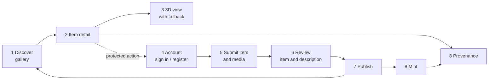

# Primary user journey

[PROPOSED] UX-01 ([#65](https://github.com/songomby-D1/devfest2026/issues/65)). Drafted by Agent 3 for rivon0507. **Sesedra, the design owner, confirms or amends this proposal before UX-02 starts the mockups.** Nothing here changes the frozen contract or the MVP scope.

This document describes who uses LOVA, the steps of the one journey the first integrated demo must show, the screens and states of each step, and the gateway route behind each of them. UX-02 (mockups), FE-02 (screens), FE-03 and FE-04 (gateway wiring) and DEMO-03 (evidence) build on it.

## Sources

- [MVP scope](../../../docs/product/MVP.md), sections A to E, especially [D. UI and UX](../../../docs/product/MVP.md#d-ui-and-ux): browse → open an item → understand the author, description and evidence → explore media, 3D or provenance.
- [Backlog](../../../docs/product/task.md): UX-01, UX-02, FE-02 to FE-04, 3D-05, DEMO-03.
- [D01 demo script and evidence checklist](../../../docs/decisions/project-decisions.md#demo-script-and-evidence-checklist): one item ID from submission to confirmed mint.
- [D13 permissions](../../../docs/decisions/project-decisions.md#d13-permissions) and the [Auth contract proposal](../../../docs/specs/auth-contract.md) for the permission matrix and `/auth/*` routes.
- [D18 editorial policy](../../../docs/decisions/project-decisions.md#d18-editorial-policy-and-demo-content): separate item and description review, rights clearance before publication.
- [ADR 0001](../../../docs/decisions/0001-d12-3d-demo-experience.md): poster, 1K GLB first, 2K on demand, still-image fallback, failure handling.
- The contract frozen at Gate 0 in the [parallel workflow](../../../docs/agents/parallel-workflow.md#contract-frozen-at-gate-0).
- Existing frontend work, read for context only: the 3D viewer on `develop` (`src/features/artwork-viewer/`), and the open draft pull requests [#80](https://github.com/songomby-D1/devfest2026/pull/80) (shell), [#96](https://github.com/songomby-D1/devfest2026/pull/96) (home and gallery rooms from Sesedra's Figma) and [#102](https://github.com/songomby-D1/devfest2026/pull/102) (WebGL museum room).

## Personas

D13 defines one signed-in account model plus a scoped `reviewer` permission. The personas below are therefore roles of one account, not separate account types. Administrative interfaces are out of MVP scope.

| Persona                     | Who                                                                                                                       | Goal                                                                                                    | Can do (D13)                                                                                                                    | Cannot do                                                                       |
| --------------------------- | ------------------------------------------------------------------------------------------------------------------------- | ------------------------------------------------------------------------------------------------------- | ------------------------------------------------------------------------------------------------------------------------------- | ------------------------------------------------------------------------------- |
| **Visitor (guest)**         | Anyone opening LOVA without signing in, on a laptop or a phone.                                                           | Discover Malagasy heritage, understand who made an item, what is claimed about it and how sure LOVA is. | Browse published items, public media, the 3D model and provenance.                                                              | See drafts, submit, review or mint. Protected actions lead to sign-in.          |
| **Contributor (signed in)** | A person who registered with an email and password. Also browses like a visitor.                                          | Share an item they hold the rights to and follow it until it is published and minted.                   | Everything a visitor can do. Submit an item with media, author details and a description. Follow the status of their own items. | Edit another person's item. Review their own submission.                        |
| **Reviewer (`reviewer`)**   | A signed-in account granted `reviewer` by an operator through the Auth CLI.                                               | Check the evidence and record separate outcomes for item claims and description claims.                 | Everything a contributor can do. Record a review on someone else's submission.                                                  | Review their own submission. Grant permissions (CLI only, no admin UI).         |
| **Mint-eligible user**      | [DECISION REQUIRED: salandri-42, shidoAdr] The item owner is proposed in the Auth contract; "any signed-in user" is open. | Create the digital provenance record of a published item.                                               | Start a mint from a published item and follow it to confirmation.                                                               | Mint a draft or unpublished item. Create a duplicate by retrying while pending. |

## Journey at a glance

The demo runs this journey for **one item ID** (D01). In demo order: the contributor submits (5), the guest checks that the draft stays hidden, the reviewer reviews (6), the item is published (7), the guest discovers it (1, 2), views it in 3D (3) and an eligible user mints it (8). The visitor journey (1 → 2 → 3 / provenance) is the primary one for design: [MVP section D](../../../docs/product/MVP.md#d-ui-and-ux) puts content presentation first.

## Steps, screens and gateway routes

The `/api/*` routes are the frozen Gate 0 routes. The `/auth/*` routes are [PROPOSED] in the Auth contract. Frontend paths are proposals: #96 uses `/`, `/musee/:room/:nn` and `/contribuer`, and #102 prepares `/galerie` and `/oeuvre/:id`. FE-02 settles the final paths with Sesedra.

| #   | Step                         | Persona                     | Screen(s)                                                                                                                                                                                                       | Gateway route(s)                                                                                                  | Proposed frontend path             |
| --- | ---------------------------- | --------------------------- | --------------------------------------------------------------------------------------------------------------------------------------------------------------------------------------------------------------- | ----------------------------------------------------------------------------------------------------------------- | ---------------------------------- |
| 1   | Discover the gallery         | Visitor                     | Home ("salon"), gallery room with lateral movement from work to work, room tabs, wall label.                                                                                                                    | `GET /api/items` (published only for guests)                                                                      | `/`, `/musee/:room/:nn`            |
| 2   | Open an item                 | Visitor                     | Item detail: media, author, description, separate item and description review labels, 3D and provenance entry points.                                                                                           | `GET /api/items/:id`                                                                                              | `/oeuvre/:id`                      |
| 3   | Explore in 3D                | Visitor                     | 3D viewer inside the item detail: poster, 1K model, orbit and preset views, "HD" (2K) control, retry.                                                                                                           | `GET /api/items/:id/model3d` → `{ status, variants: { poster, glb1k, glb2k } }`                                   | `/oeuvre/:id` (panel or section)   |
| 4   | Create or open an account    | Visitor → contributor       | Sign-in, register, signed-in header state, sign-out. Reached from "Déposer une œuvre" or any protected action.                                                                                                  | `POST /auth/register`, `POST /auth/login`, `POST /auth/logout`, `GET /auth/me`                                    | `/connexion`, `/inscription`       |
| 5   | Submit an item and media     | Contributor                 | Submission form: media upload (image or video), author details, metadata, description, rights confirmation, then a confirmation screen showing the draft.                                                       | `POST /api/items`, then `POST /api/items/:id/media`                                                               | `/contribuer`                      |
| 6   | Follow and record the review | Contributor, reviewer       | Contributor: "My submission" status view with item and description claim status. Reviewer: review screen with evidence, separate outcome and rationale for item claims and for description claims.              | `GET /api/items/:id` (owner or reviewer), `POST /api/items/:id/review`                                            | `/contribuer/:id`, `/revue/:id`    |
| 7   | Publish                      | Reviewer or Content policy  | Publication status change visible on the status view; the item appears in the gallery.                                                                                                                          | See [open question Q1](#open-questions-and-contract-gaps). Publication status comes back on `GET /api/items/:id`. | same as step 6                     |
| 8   | Mint and provenance          | Mint-eligible user, visitor | "Create the provenance record" action on a published item, wallet confirmation if required, pending → confirmed or failed, then the provenance panel with chain, token, transaction and the scope of the claim. | `POST /api/items/:id/mint` (with idempotency key), `GET /api/items/:id/provenance` (polled while pending, D16)    | `/oeuvre/:id` (provenance section) |

### 1. Discover the gallery

- The visitor lands on the home page and enters a room. They move laterally from work to work (arrows, swipe on mobile, keyboard on desktop). The wall label gives title, author and a short claim-status hint.
- Only `published` items appear. A `draft` or `unpublished` item never appears to a guest, even through a direct link (D01 step 2).
- Each work links to its item detail.

### 2. Item detail

- Shows, in this order of importance: the media, the author, the description, then the **two review labels**, item claims and description claims, each `verified`, `unreviewed` or `uncertain`. Labels are separate from publication status and never merged into one badge (MVP B, D18).
- `unreviewed` and `uncertain` information stays visibly qualified next to the text it applies to. An automated suggestion never shows as verified.
- Entry points to the 3D view (when `model3d.status` is `ready`) and to provenance (when a mint is confirmed).
- A guest on a protected action ("Mint", "Edit") is sent to sign-in and brought back to the same item afterwards.

### 3. 3D view with fallbacks

Follows ADR 0001 and the viewer already on `develop`:

1. The poster shows immediately and doubles as the still-image fallback.
2. The 1K GLB loads on every device. The visitor rotates with drag or touch and uses preset views; the bottom view only shows when the bottom was scanned.
3. The "HD" control loads the 2K GLB on request. If 2K fails or the WebGL context is lost, the viewer returns to 1K and hides the control.
4. Every failure keeps the item detail usable (see [states](#states)).
5. AR is optional and only shown if 3D-05b validates it on an iPhone.

### 4. Account

- Sign-in and register are short email and password forms. Errors use the public error shape `{ code, message, requestId }` and show `message`, never internal details. `INVALID_CREDENTIALS` is one generic message for wrong email or password.
- Signed-in state is visible in the header with a sign-out action. An expired session (`SESSION_INVALID`) returns the user to sign-in with their place kept.
- No social login, password reset or account administration in the MVP.

### 5. Submit item and media

- One form, in two gateway calls: `POST /api/items` creates the draft with author details, metadata and description, then `POST /api/items/:id/media` attaches the image or video. The UI presents this as one submission and shows progress for the upload.
- The contributor confirms they hold the rights to the media (D18). Formats and size limits come from the Content owner and are shown before upload.
- If the media upload fails, the draft is not published and the contributor can retry the upload on the same draft; the UI never shows a half-submitted item as published (MVP B).
- On success the contributor sees the draft with its item ID, `draft` publication status and both claim statuses `unreviewed`.

### 6. Review status: item and description

- **Contributor view.** A status view of their own item showing publication status and the two claim statuses side by side, with the reviewer's rationale once recorded. Re-review applies after a material change (D18).
- **Reviewer view.** For an item they did not submit: the media, the claims, the evidence field, and two independent outcome selectors (`verified`, `uncertain`, or leave `unreviewed`) each with a rationale. The review action is hidden for the submitter's own item, and the service refuses it anyway.
- AI-assisted signals (CONTENT-05) may appear as advisory hints only and never set a status.

### 7. Publish

- Publication requires rights clearance and both reviews recorded (D18). Once `published`, the item appears in the gallery for guests with the recorded labels (D01 step 3).
- `unpublished` removes it from public browsing; the owner still sees it in their status view.
- The trigger for publication is not in the frozen route list: see [Q1](#open-questions-and-contract-gaps).

### 8. Mint and provenance

- Available only on a `published` item and only to an eligible user. The button explains in one sentence what the record establishes: a digital event linked to this item, **not** physical authenticity or intellectual property ownership (MVP C).
- Starting a mint sends `POST /api/items/:id/mint` with an idempotency key generated once per attempt and reused on retries. The button is disabled while `pending`, so repeated clicks never create a duplicate.
- The wallet step, if any, follows the D10 choice. A rejected signature leads to the `failed` state with a recoverable retry.
- The UI polls `GET /api/items/:id/provenance` while `pending` (D16) and shows `confirmed` with the chain, the token and the transaction reference, each linkable to an explorer, plus the scope of the provenance claim.
- Visitors see the provenance panel of a confirmed item read-only.

## States

Every screen designs these states. Messages are short, in French in the UI, and show the public error `message` and `requestId` (for support) but no internal details.

### Common data states

| State                   | Where                         | Treatment                                                                                                                                             |
| ----------------------- | ----------------------------- | ----------------------------------------------------------------------------------------------------------------------------------------------------- |
| Loading                 | Gallery, item detail, status  | Skeleton or poster placeholder at the final size so the layout does not jump. Respect reduced motion.                                                 |
| Empty                   | Gallery, a room, my items     | "Salle en préparation" for an empty room (as in #96); "No submission yet" with a link to submit for a contributor.                                    |
| Not found / not visible | Item detail                   | Same "not found" page for a missing item and for a draft seen by a guest, so drafts do not leak.                                                      |
| Error                   | Any gateway call              | Inline message with a retry action. `503 AUTH_UNAVAILABLE` on a protected action says the account service is unavailable; public pages stay readable. |
| Unauthorized            | Protected action              | Redirect to sign-in and back; `SESSION_INVALID` treated the same.                                                                                     |
| Forbidden               | Review own item, edit other's | Action hidden; if the service still refuses, a plain explanation.                                                                                     |

### Claim and publication states

| Field                           | Values                                | Treatment                                                                    |
| ------------------------------- | ------------------------------------- | ---------------------------------------------------------------------------- |
| Item claims, description claims | `unreviewed`, `verified`, `uncertain` | Two separate labels, each with text and icon, never color alone.             |
| Publication                     | `draft`, `published`, `unpublished`   | Shown to the owner and reviewers only; guests only ever see published items. |

### 3D states

| Contract or viewer state             | Treatment (ADR 0001)                                                     |
| ------------------------------------ | ------------------------------------------------------------------------ |
| `model3d.status = ready`, loading 1K | Poster with a loading indicator.                                         |
| Ready                                | Interactive model, preset views, HD control.                             |
| `model3d.status = processing`        | Poster or media only, with "3D model in preparation". No viewer started. |
| `model3d.status = missing`           | No 3D entry point; the item detail shows its media only.                 |
| WebGL unavailable                    | Poster as a still image with a short message.                            |
| 1K load fails or network drops       | Poster kept, retry action.                                               |
| 2K fails or context lost             | Back to 1K, HD control hidden, short notice.                             |
| AR fails                             | AR button hidden, 3D view kept.                                          |

### Mint states

| State                     | Treatment                                                                                           |
| ------------------------- | --------------------------------------------------------------------------------------------------- |
| Not minted                | "Create the provenance record" for an eligible user; nothing for others.                            |
| Awaiting wallet signature | Instructions for the wallet step; cancel returns to "not minted".                                   |
| `pending`                 | Progress indicator, action disabled, polling. Leaving and coming back resumes the same status.      |
| `confirmed`               | Chain, token, transaction reference, linked item and the scope of the claim.                        |
| `failed`                  | Plain reason from `message`, retry with the same idempotency key semantics, item page still usable. |

## Desktop and mobile

| Aspect      | Desktop (presenter laptop, D01)                                                   | Mobile (second demo device)                                                                                          |
| ----------- | --------------------------------------------------------------------------------- | -------------------------------------------------------------------------------------------------------------------- |
| Gallery     | Figma stage 1440×900 fitted to the viewport (#96); keyboard and arrow navigation. | Swipe between works; room tabs reachable with the thumb; no hover-only information.                                  |
| Item detail | Media and 3D beside the text and labels.                                          | Single column: media or poster first, then author, labels, description, then 3D and provenance.                      |
| 3D          | 1K first, HD control visible.                                                     | 1K only by default (ADR 0001), HD on request; touch orbit must not trap page scroll; AR only if 3D-05b validates it. |
| Forms       | Two-column layout allowed for author and metadata fields.                         | One field per row, native file picker and camera for media, large tap targets.                                       |
| Wallet      | Browser wallet extension.                                                         | Depends on D10 mobile support; if unsupported, mint is a desktop step and mobile shows provenance read-only.         |
| Motion      | GSAP transitions per `docs/motion.md` (#96).                                      | Same, lighter; all motion honors `prefers-reduced-motion`.                                                           |

Both layouts are checked on the agreed demo devices under 3D-05b and DEMO-03.

## Open questions and contract gaps

These do not change the frozen contract. If the answer needs a route or field, it goes through a `[CONTRACT CHANGE]` pull request; meanwhile the frontend uses mocks (`VITE_API_MODE=mock`) and a local adapter.

| ID  | Question                                                                                                                                                                                                     | Owner                 |
| --- | ------------------------------------------------------------------------------------------------------------------------------------------------------------------------------------------------------------ | --------------------- |
| Q1  | What triggers publication? The frozen routes have no publish route. Is publication a side effect of `POST /api/items/:id/review` once both outcomes and rights clearance are recorded, or a separate action? | papangoo, endy-rkt    |
| Q2  | How does a contributor list their own items, and a reviewer the items awaiting review? `GET /api/items` would need a caller-scoped filter, otherwise the status views open only by item ID.                  | papangoo, endy-rkt    |
| Q3  | Who is mint-eligible: the item owner only, or any signed-in user?                                                                                                                                            | salandri-42, shidoAdr |
| Q4  | Is there a wallet step for the user (D10), or does the NFT service sign on the platform's behalf? This decides whether mint works on mobile.                                                                 | salandri-42           |
| Q5  | Does the item detail response carry the claim statuses, the reviewer rationale and the publication status, or does the frontend need another call?                                                           | papangoo              |
| Q6  | Final frontend paths and French screen labels.                                                                                                                                                               | Sesedra               |

## Acceptance criteria for UX-01

The issue has no acceptance criteria; these are proposed for Sesedra to confirm.

- **AC1.** The document names the personas (visitor, contributor, reviewer, mint-eligible user) and what each can and cannot do, consistent with D13 and the Auth contract permission matrix.
- **AC2.** The journey covers, in order, discover → item detail → 3D view → account → submit item and media → separate item and description review → publish → mint and provenance, for one item ID as required by D01.
- **AC3.** Each step lists its screens and the gateway route that backs it, using only frozen Gate 0 routes and the proposed `/auth/*` routes. Every gap is listed as an open question rather than an invented route.
- **AC4.** Each step lists its loading, empty, error, unauthorized and not-found states; the 3D section covers `ready`, `processing` and `missing` and every ADR 0001 failure; the mint section covers `pending`, `confirmed` and `failed`, including idempotent retry.
- **AC5.** Item claims and description claims are shown as separate labels, distinct from publication status, and drafts never reach guests.
- **AC6.** Desktop and mobile differences are stated for each main screen.
- **AC7.** Sesedra reviews the document and either approves it or records changes, and UX-02 uses it as the screen list for the mockups.
- **AC8.** The file passes the repository Prettier check.
