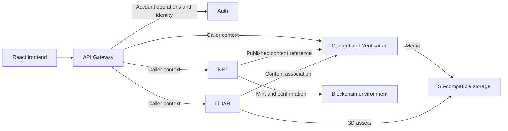

# Architecture overview

This page defines the required topology and presents decisions on the gateway, communication and repository layout.

[CONFIRMED] Microservices are mandatory. Auth, Content & Verification, NFT and LiDAR are independently deployable NestJS services with a dedicated API gateway. The React/TypeScript frontend uses the gateway as its sole application entry point. Each service has its own application boundary, data ownership, explicit contract, appropriate tests and a future Dockerfile. Add business services only with written justification.

[CONFIRMED] Every future Dockerfile lives in its own application or service directory. `infrastructure/docker/` is reserved for non-service configuration. See [per-service Dockerfile placement](services.md#dockerfile-placement).

[NOT IMPLEMENTED] The diagram shows proposed dependencies. Auth owns the identity the gateway validates and propagates. Resource authorization stays with the owning service.



## Gateway and networking

[CTO DECISION REQUIRED] **D06 Gateway and Nginx.** [RECOMMENDED] Use a thin NestJS gateway and omit Nginx for the MVP. NestJS gives one place for request routing, edge validation, identity checks and error translation, with the same development model as the services. A lighter dedicated proxy can work if its configuration covers these requirements cleanly. If deployment later needs static serving, TLS termination or buffering, Nginx can own those edge concerns while the gateway retains API policy.

[CTO DECISION REQUIRED] **D07 Identity propagation and logout.** [RECOMMENDED] Start with Auth-owned revocable opaque sessions and synchronous verification of protected requests. Use a secure HTTP-only cookie in deployed environments with CSRF safeguards for cookie-authenticated writes. Compare this option with locally validated short-lived signed tokens and explicit revocation semantics. The gateway strips client-supplied identity headers, authenticates through Auth and sends a minimal caller identity and permissions over authenticated service calls. Services trust context only from authenticated peers and authorize access to their own resources. Service-to-service calls use a service identity with least privilege and carry user context only when it is needed and its origin can be validated.

[RECOMMENDED] Use Compose service names and explicit connection timeouts. Keep service listeners on the internal network. The gateway normalizes public errors and rejects malformed requests, while services validate their inputs and domain rules. Prefer a same-origin frontend setup. For separate development origins, allow only configured frontend origins at the gateway. Apply targeted limits to auth attempts and expensive writes if exposure warrants them. Use the error and contract conventions in [services](services.md).

## Communication and long-running work

[CONFIRMED] Start with synchronous HTTP. Kubernetes, Kafka, RabbitMQ, a service mesh and distributed orchestration require demonstrated need.

[CTO DECISION REQUIRED] **D16 Async processing.** [RECOMMENDED] Expose a status the frontend can poll through the gateway for NFT confirmation. Prefer offline 3D preparation and sized media accepted as-is for the demo. Add an owning-service PostgreSQL job table with bounded retries and idempotent processing only if media processing, LiDAR work or NFT confirmation must continue across requests and restarts. Revisit a broker only when measured backlog, throughput, retry isolation or cross-service delivery requirements exceed that design.

## Proposed repository layout

[CONFIRMED]: `apps/backend/<service>/` is the backend service layout approved under D03.

[RECOMMENDED] Evaluate this baseline under D03. The paths show the proposed layout.

```text
apps/frontend/Dockerfile
apps/backend/{gateway,auth,content,nft,lidar}/Dockerfile
docker-compose.yml
infrastructure/docker/
```

The root Compose file would reference each application's build context and Dockerfile. Reserve `infrastructure/docker/` for non-service configuration such as database initialization scripts, storage settings and Nginx configuration if used.

## Future deployment

[NOT IMPLEMENTED] Use a multi-stage Dockerfile in each application or service directory, with a slim runtime, a non-root user and a dedicated ignore file. Use `.dockerignore` when that directory is the build context and an adjacent `Dockerfile.dockerignore` for repository-root builds. The Dockerfile-specific file takes precedence over the root ignore file, so keep required exclusions in it. The root Compose file would define published ports and runtime environment variables and compose the frontend, gateway, four services, PostgreSQL, object storage and Nginx if needed. Future cloud deployment can run the same images with managed PostgreSQL and S3-compatible storage. [Docker build contexts and ignore files](https://docs.docker.com/build/concepts/context/) · [Backup plan](data-storage.md#backup-and-migration)
