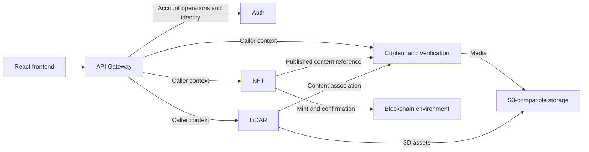

# Architecture overview

This page defines the required topology and presents decisions on the gateway, communication and repository layout.

[CONFIRMED] Microservices are mandatory. Auth, Content & Verification, NFT and LiDAR are independently deployable NestJS services with a dedicated API gateway. The React/TypeScript frontend uses the gateway as its sole application entry point. Each service has its own application boundary, data ownership, explicit contract, appropriate tests and a future Dockerfile. Add business services only with written justification.

[CONFIRMED] endy-rkt maintains the system overview. App and service owners maintain their own implementation, tests, Dockerfile and entry in the shared Compose file. Stateful services use Prisma with one shared PostgreSQL instance per environment. [Dockerfile placement](services.md#dockerfile-placement) · [Data ownership](data-storage.md#postgresql-isolation)

[NOT IMPLEMENTED] The diagram shows proposed dependencies. Auth owns the identity the gateway validates and propagates. Resource authorization stays with the owning service.



## Gateway and networking

[CONFIRMED] **D06 Gateway and Nginx.** Use the dedicated NestJS gateway and defer Nginx. The gateway owns API routing, edge validation and public error mapping. Owning services retain resource authorization. [D06 decision](../decisions/project-decisions.md#d06-gateway-deployment-boundary)

[CONFIRMED] **D07 Identity propagation and logout.** Auth owns revocable opaque sessions and verifies each protected gateway request. For cookie-authenticated writes, use CSRF safeguards and a secure HTTP-only cookie in deployed environments. Strip client-supplied identity headers and accept caller context only from authenticated peers. Auth and Gateway agree the exact caller context, service authentication, expiry and error behavior under endy-rkt-08. [D07 decision](../decisions/project-decisions.md#d07-identity-propagation-and-logout)

[RECOMMENDED] Use Compose service names and explicit connection timeouts. Keep service listeners on the internal network. The gateway normalizes public errors and rejects malformed requests, while services validate their inputs and domain rules. Prefer a same-origin frontend setup. For separate development origins, allow only configured frontend origins at the gateway. Apply targeted limits to auth attempts and expensive writes if exposure warrants them. Use the error and contract conventions in [services](services.md).

[CONFIRMED] Under D14, API producers own their OpenAPI contracts in `docs/api/` and agree changes with affected consumers. endy-rkt owns the public gateway contract and shared conventions. The frontend uses that public contract. Start with service-owned contracts and share transport declarations only when multiple consumers need them, using type-only imports. [Contract and error policy](services.md#contracts-and-shared-package)

## Communication and long-running work

[CONFIRMED] Start with synchronous HTTP. Kubernetes, Kafka, RabbitMQ, a service mesh and distributed orchestration require demonstrated need.

[CONFIRMED] **D16 Async processing.** Start with synchronous HTTP and gateway status polling. Prefer offline 3D preparation. The baseline passed validation under endy-rkt-06 against the NFT and LiDAR proposals: no broker is deployed and status is read over HTTP. Reopen the decision only if a concrete cross-service need emerges. [D16 decision](../decisions/project-decisions.md#d16-system-wide-async-infrastructure)

## Proposed repository layout

[CONFIRMED]: `apps/backend/<service>/` is the backend service layout approved under D03.

[RECOMMENDED] Evaluate this baseline under D03. The paths show the proposed layout.

```text
apps/frontend/Dockerfile
apps/backend/{gateway,auth,content,nft,lidar}/Dockerfile
docker-compose.yml
infrastructure/docker/
```

The root Compose file would reference each application's build context and Dockerfile and declare one shared PostgreSQL service. Reserve `infrastructure/docker/` for non-service configuration such as database initialization scripts, storage settings and Nginx configuration if used.

## Future deployment

[CONFIRMED] Under D14, builds that need `packages/shared`, the root npm lockfile or another repository-root input use `context: .` in root Compose and an adjacent `Dockerfile.dockerignore`. Use an app-local context and `.dockerignore` only when all required build inputs are app-local. Keep each Dockerfile in the owning app or service directory. Exclude local env files, credentials, VCS data and local artifacts while retaining declared inputs. Test shared-input changes in every dependent workspace and include each dependent image in the rebuild scope when Docker CI lands. [Dockerfile placement and build contexts](services.md#dockerfile-placement)

[NOT IMPLEMENTED] Build each image independently with a multi-stage Dockerfile, a slim non-root runtime, and only the target application's runtime artifacts and dependencies. The root Compose file would define published ports and runtime environment variables and compose the frontend, gateway, four services, PostgreSQL, object storage and Nginx if needed. Future cloud deployment can run the same images with managed PostgreSQL and S3-compatible storage. [Backup plan](data-storage.md#backup-and-migration)
