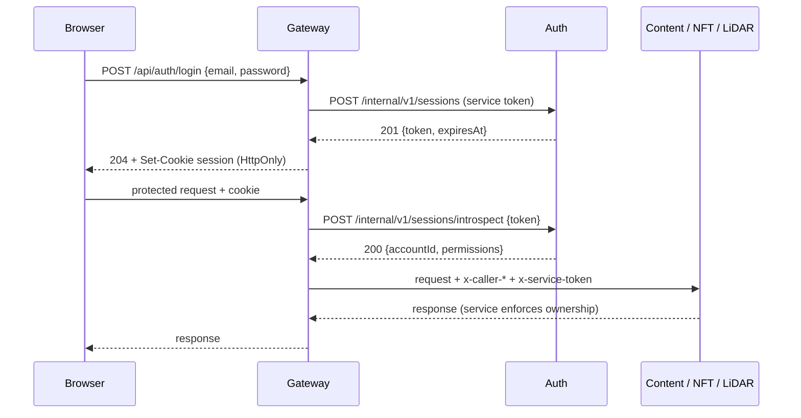

# Auth contract specification

[IMPLEMENTED] Owner: shidoAdr, implemented by Agent 1 under the [parallel workflow](../agents/parallel-workflow.md). Reviewer: endy-rkt (gateway and system-wide conventions). The Gate 0 [platform contract](platform-contract.md) supersedes the header and route names below where they differ. Implementation: [apps/backend/auth](../../apps/backend/auth/README.md) and [apps/backend/gateway](../../apps/backend/gateway/README.md).

It covers the Auth side of [endy-rkt-05](../product/task.md#endy-rkt-decisions-and-spikes) and [endy-rkt-08](../product/task.md#endy-rkt-foundation) and frames AUTH-07 (#97) and AUTH-01 to AUTH-06 (#46–#51).

## Goal

Agree, before any Auth code exists, how accounts, revocable opaque sessions (D07) and permissions (D13) work across Auth, the gateway and the owning services. The contract fixes the caller context the gateway propagates, how services trust it, session expiry and logout, and one error shape, so that Gateway, Content, NFT and LiDAR can build against it in parallel.

## User story

As a visitor, I want to browse published items as a guest and register, log in and log out with an email and password, so that I can take account-bound actions (upload, review, mint) only while my session is valid.

As a service owner, I want a trusted, minimal caller context on each request, so that my service can enforce resource authorization without handling credentials.

## Flow

## Contract proposal

### Auth internal API (consumer: gateway only)

All routes require `x-service-name: gateway` and `x-service-token` matching `AUTH_INBOUND_TOKEN_GATEWAY` and accept `x-request-id`.

| Method and path                         | Request               | Success                                     | Errors                                                  |
| --------------------------------------- | --------------------- | ------------------------------------------- | ------------------------------------------------------- |
| `POST /internal/v1/accounts`            | `{ email, password }` | `201 { accountId }`                         | `400 VALIDATION_FAILED`, `409 EMAIL_ALREADY_REGISTERED` |
| `POST /internal/v1/sessions`            | `{ email, password }` | `201 { token, expiresAt }`                  | `400 VALIDATION_FAILED`, `401 INVALID_CREDENTIALS`      |
| `POST /internal/v1/sessions/introspect` | `{ token }`           | `200 { accountId, permissions, expiresAt }` | `401 SESSION_INVALID`                                   |
| `POST /internal/v1/sessions/revoke`     | `{ token }`           | `204` (idempotent)                          | `400 VALIDATION_FAILED`                                 |

The token travels in the body, never in a URL, so it does not reach access logs. `expiresAt` is the earlier of the idle and absolute limits.

### Public routes (gateway contract, owned by endy-rkt)

[CONFIRMED] `POST /api/auth/register`, `POST /api/auth/login`, `POST /api/auth/logout`, `GET /api/auth/me` (`{ userId, email, displayName, permissions, sessionExpiresAt }`), as frozen in the [gateway OpenAPI document](../api/gateway.openapi.yaml). On login the gateway sets the session cookie: `HttpOnly`, `SameSite=Lax`, `Path=/`, and `Secure` with the `__Host-` prefix in deployed environments, as required by D07 ([overview.md:29](../architecture/overview.md#gateway-and-networking)). Logout clears the cookie.

### Caller context (gateway → Content, NFT, LiDAR)

| Header                 | Meaning                                                                            |
| ---------------------- | ---------------------------------------------------------------------------------- |
| `x-service-token`      | Secret dedicated to the target service, from the gateway environment.              |
| `x-caller-user-id`     | Opaque account ID (UUID v4 generated by Auth, never the email). Absent for guests. |
| `x-caller-permissions` | Comma-separated permissions, for example `reviewer`. Empty when none.              |
| `x-request-id`         | Correlation ID, generated by the gateway when missing.                             |

| `x-service-name` | Calling service: `gateway`, `nft` or `lidar`. |

The gateway strips every client-supplied `x-caller-*`, `x-service-name` and `x-service-token` header before routing ([overview.md:29](../architecture/overview.md#gateway-and-networking)). Services listen on the internal network only ([overview.md:31](../architecture/overview.md#gateway-and-networking)).

Each receiving service holds one inbound secret per allowed caller, for example Content holds `CONTENT_INBOUND_TOKEN_GATEWAY`, `CONTENT_INBOUND_TOKEN_NFT` and `CONTENT_INBOUND_TOKEN_LIDAR` for the NFT → Content and LiDAR → Content calls ([overview.md:18-19](../architecture/overview.md)). A receiver authenticates the pair (`x-service-name`, `x-service-token`). It trusts `x-caller-*` headers only from `gateway`. A service-to-service call relays the gateway's caller context unchanged when it acts for a user, and omits it otherwise. A leaked secret then compromises one caller–receiver pair only and can be rotated alone.

### Permission matrix (D13, to confirm under endy-rkt-05)

Auth provides identity and permissions. The owning service enforces the rule ([services.md:9](../architecture/services.md)).

| Action                                               | Guest | Signed in     | Owner of the resource | `reviewer`    | Enforced by                                                         |
| ---------------------------------------------------- | ----- | ------------- | --------------------- | ------------- | ------------------------------------------------------------------- |
| Browse published items, public media, 3D, provenance | ✅    | ✅            | ✅                    | ✅            | Content, LiDAR, NFT                                                 |
| Register, log in                                     | ✅    | –             | –                     | –             | Auth                                                                |
| Log out, read own account                            | ❌    | ✅            | –                     | –             | Auth                                                                |
| Submit an item and media                             | ❌    | ✅            | –                     | –             | Content                                                             |
| Edit or withdraw own unpublished item                | ❌    | ❌            | ✅                    | –             | Content                                                             |
| Record a review of item or description claims        | ❌    | ❌            | ❌ own submission     | ✅            | Content ([MVP.md:31](../product/MVP.md#b-content-and-verification)) |
| Request a mint for a published item                  | ❌    | open question | ✅ (proposed)         | –             | NFT                                                                 |
| Associate a 3D asset with an item                    | ❌    | ❌            | open question         | open question | LiDAR                                                               |

The only permission in the MVP is `reviewer`. An operator grants or revokes it with an Auth CLI command (`grant-permission` / `revoke-permission`) because administrative interfaces are outside MVP scope ([MVP.md:53](../product/MVP.md)).

### Error shape

Every Auth error body is `{ code, message, requestId }`, where `message` is safe to show. Codes: `VALIDATION_FAILED` (400, with `details: [{ field, reason }]`), `INVALID_CREDENTIALS` (401), `SESSION_INVALID` (401, the same for unknown, expired and revoked sessions), `SERVICE_UNAUTHENTICATED` (401), `EMAIL_ALREADY_REGISTERED` (409), `INTERNAL_ERROR` (500). The gateway maps an Auth timeout or connection failure to `503 AUTH_UNAVAILABLE` and fails closed ([services.md:33](../architecture/services.md#contracts-and-shared-package)).

## Acceptance criteria

- **CA1** (AUTH-01) Given no account for `ana@example.org`, when the gateway calls `POST /internal/v1/accounts` with that email and a valid password, then Auth returns `201 { accountId }` and stores only a password hash.
- **CA2** (AUTH-01) Given an account for `ana@example.org`, when someone registers ` ANA@example.org`, then Auth returns `409 EMAIL_ALREADY_REGISTERED` and creates nothing.
- **CA3** (AUTH-01) Given an invalid email, a password shorter than 12 or longer than 128 characters, or an unknown field, when registering, then Auth returns `400 VALIDATION_FAILED` with the failing fields and creates nothing.
- **CA4** (AUTH-02) Given a registered account, when logging in with the right credentials, then Auth returns `201 { token, expiresAt }`, persists only the SHA-256 hash of the token, and the gateway sets the session cookie.
- **CA5** (AUTH-02) Given a wrong password or an unknown email, when logging in, then Auth returns the same `401 INVALID_CREDENTIALS` body in both cases and runs a password hash in both cases.
- **CA6** (AUTH-06) Given a valid session, when the gateway introspects its token, then Auth returns `200 { accountId, permissions, expiresAt }` and extends the idle deadline.
- **CA7** (AUTH-06) Given a session unused for more than 2 hours, when it is introspected, then Auth returns `401 SESSION_INVALID`.
- **CA8** (AUTH-06) Given a session created more than 7 days ago and used continuously, when it is introspected, then Auth returns `401 SESSION_INVALID`.
- **CA9** (AUTH-03) Given a signed-in user, when they log out, then Auth revokes the session, the gateway clears the cookie, and the next protected request with the old token gets `401 SESSION_INVALID`. A second revoke of the same token also returns `204`.
- **CA10** (AUTH-04) Given a request without a session cookie to a public route, when the gateway routes it, then it does not call Auth and forwards no `x-caller-user-id`, and the service answers as for a guest.
- **CA11** (AUTH-06) Given a client request carrying `x-caller-user-id` or `x-caller-permissions`, when the gateway routes it, then those headers are replaced by values derived from the verified session, or removed for a guest.
- **CA12** (AUTH-06, AUTH-07) Given a request to Auth's internal API or to a service with a missing or wrong `x-service-token` for its `x-service-name`, then the receiver returns `401 SERVICE_UNAUTHENTICATED` and ignores any caller headers. Given a valid `nft` caller that relays `x-caller-user-id` to Content, then Content applies that caller context, and given `x-caller-*` headers from an unknown `x-service-name`, then Content returns `401 SERVICE_UNAUTHENTICATED`.
- **CA13** (AUTH-05) Given an operator grants `reviewer` to an account, when that account's next request is introspected, then `permissions` contains `reviewer`. After revocation, the next introspection no longer contains it.
- **CA14** (AUTH-06) Given Auth times out or is down, when a protected request arrives at the gateway, then the gateway returns `503 AUTH_UNAVAILABLE` and does not forward the request.
- **CA15** (all) Given any Auth error, then the body has the `{ code, message, requestId }` shape without stack traces, emails, tokens or hashes, and no log line contains a password, token or email.
- **CA16** (AUTH-07) Given the Auth workspace, when `typecheck`, `test` and `build` run, then they pass, the Dockerfile builds, and the service starts in root Compose against its own PostgreSQL database and role (D04).

## Out of scope

Email verification, password reset, password change, account deletion, MFA, OAuth or social login, "log out all sessions", an administration UI, refresh tokens or JWT sessions for browsers, an account lockout policy, and caching introspection results at the gateway.

## Edge cases and errors

| Case                                                      | Expected behavior                                                                                                                   |
| --------------------------------------------------------- | ----------------------------------------------------------------------------------------------------------------------------------- |
| Email with surrounding spaces or upper case               | Trimmed and lower-cased before validation and uniqueness checks (CA2).                                                              |
| Email longer than 254 characters or malformed             | `400 VALIDATION_FAILED`.                                                                                                            |
| Password with Unicode or spaces                           | Accepted, normalized with NFKC, length counted in code points, 12 to 128 inclusive.                                                 |
| Password longer than 128 characters                       | `400 VALIDATION_FAILED` before hashing, which caps hashing cost.                                                                    |
| Body that is empty, not JSON, or larger than 10 KB        | `400 VALIDATION_FAILED`.                                                                                                            |
| Two concurrent registrations with the same email          | The database unique constraint lets exactly one succeed, and the other gets `409`.                                                  |
| Malformed, empty or unknown token in introspect or revoke | Introspect returns `401 SESSION_INVALID`. Revoke returns `204` and changes nothing.                                                 |
| Expired or revoked token reused                           | `401 SESSION_INVALID`, the same as unknown.                                                                                         |
| Database unavailable                                      | `500 INTERNAL_ERROR` from Auth, mapped by the gateway. No partial account is created.                                               |
| Auth slow or down                                         | The gateway times out and returns `503 AUTH_UNAVAILABLE` (CA14).                                                                    |
| A permission revoked during an active session             | Takes effect on the next introspection (CA13).                                                                                      |
| Expired and revoked session rows accumulate               | An Auth CLI command `purge-sessions` deletes rows past their absolute expiry, run before a demo. Scheduled purging is out of scope. |

## Technical constraints

- **Stack.** NestJS service with Prisma on the shared PostgreSQL instance, with a dedicated database and roles (D04) ([overview.md:5-7](../architecture/overview.md), [data-storage.md:11](../architecture/data-storage.md#postgresql-isolation)). Node 22 under D15 ([project-decisions.md:43](../decisions/project-decisions.md#d15-node-and-npm-workspace-runtime)). The NestJS, Prisma and validation library versions are **not verified**: no backend manifest or lockfile exists yet. They are fixed in AUTH-07 after endy-rkt-07 and endy-rkt-19.
- **Passwords.** Hash with `scrypt` from `node:crypto`, so no new dependency is needed. Use a per-password random salt, the parameters stored with the hash, and a constant-time comparison (`crypto.timingSafeEqual`). Use N=2^17, r=8, p=1, which needs `maxmem` raised above Node's 32 MiB default. [OWASP Password Storage](https://cheatsheetseries.owasp.org/cheatsheets/Password_Storage_Cheat_Sheet.html) · [Node crypto.scrypt](https://nodejs.org/docs/latest-v22.x/api/crypto.html#cryptoscryptpassword-salt-keylen-options-callback).
- **Hashing cost.** Each scrypt hash uses about 128 MiB (128 · N · r bytes). Auth limits concurrent hashes with a small in-process queue (default 4) and answers `503` beyond a short wait. Gateway rate limits bound the rest. This is the price of the OWASP minimum and is to be measured in AUTH-02.
- **Session tokens.** 32 bytes from `crypto.randomBytes`, base64url-encoded. Only the SHA-256 hash is stored. Introspection updates `lastSeenAt` at most once per minute to limit writes.
- **Service tokens.** One secret per receiving service, at least 32 random bytes, supplied through `.env` and compared in constant time. Placeholders go in `.env.example` and never in commits ([code-policy.md, Environment and secrets](../development/code-policy.md#environment-and-secrets)).
- **CSRF.** `SameSite=Lax` plus a gateway check of `Origin` against the configured frontend origins on state-changing requests. This is the gateway owner's choice under D07. [OWASP CSRF Prevention](https://cheatsheetseries.owasp.org/cheatsheets/Cross-Site_Request_Forgery_Prevention_Cheat_Sheet.html).
- **Rate limiting.** Targeted per-IP limits on `/auth/login` and `/auth/register` at the gateway ([overview.md:31](../architecture/overview.md#gateway-and-networking)). Auth itself does not lock accounts.
- **Validation and logs.** Validate DTOs at the HTTP edge and reject unknown fields ([code-policy.md:54-55](../development/code-policy.md)). Log `accountId` and `requestId` only, through the Nest logger.
- **Performance.** One synchronous introspection per protected request (D16). Target under 50 ms at p95 locally, excluding login hashing (**not verified**, to be measured in AUTH-06).

## Architecture impact

Auth (`apps/backend/auth/`, new):

- **Domain.** `Account`, `Email` and `Password` value objects with normalization and the length policy, `Session` with its idle and absolute expiry rules, and `Permission` (`reviewer`).
- **Application.** `RegisterAccount`, `Login`, `IntrospectSession`, `RevokeSession`, `GrantPermission` and `RevokePermission` use cases. Ports: `AccountRepository`, `SessionRepository`, `PasswordHasher`, `TokenGenerator`, `Clock`.
- **Infrastructure.** Prisma repositories and schema (`Account`, `Session`, `AccountPermission`), plus `ScryptPasswordHasher` and `RandomTokenGenerator`.
- **Interface.** Internal controllers, `ServiceTokenGuard`, DTO validation, an error filter that produces the error shape, and the permission CLI.
- **Packaging.** `Dockerfile` and a root Compose entry (AUTH-07).

Contract files:

- `docs/api/auth.openapi.yaml` describes the internal API (Auth-owned, D14).
- The public routes, CSRF and rate limits go into endy-rkt's gateway contract.

Other services:

- Gateway: session cookie handling, introspection call, header stripping and injection, and error mapping (endy-rkt, GATEWAY-01).
- Content, NFT and LiDAR: each needs an inbound `ServiceTokenGuard` and caller-context parsing. Any shared header declarations stay type-only in `packages/shared` (D14).

Environment variables:

- Auth: `AUTH_DATABASE_URL` and `AUTH_INBOUND_TOKEN_GATEWAY`.
- Gateway: one outbound token per service.
- Each service: one `<RECEIVER>_INBOUND_TOKEN_<CALLER>` per allowed caller, and one outbound token per service it calls.

New dependencies: none beyond NestJS and Prisma, which are already confirmed. A DTO validation library is chosen with the scaffold in AUTH-07.

## Test plan

| Criterion        | Automated test                                                                                                                                                                  |
| ---------------- | ------------------------------------------------------------------------------------------------------------------------------------------------------------------------------- |
| CA1, CA2, CA3    | HTTP + PostgreSQL integration tests on `POST /internal/v1/accounts`. Unit tests for `Email` and `Password` normalization and limits. A concurrency test for the duplicate race. |
| CA4, CA5         | Integration tests: login success stores only the token hash. Wrong password and unknown email return identical bodies, and a spy shows the hasher runs in both cases.           |
| CA6, CA7, CA8    | Unit tests of `Session` expiry with a fake `Clock` (1 h 59, 2 h 01, 7 days with continuous use). An integration test checks that introspection slides `lastSeenAt`.             |
| CA9              | Integration test: login → revoke → introspect returns 401, and a second revoke returns 204.                                                                                     |
| CA10, CA11, CA14 | Gateway tests (endy-rkt): no Auth call for guests, spoofed headers replaced, Auth stub timeout returns 503 without forwarding.                                                  |
| CA12             | Guard tests in Auth and each service: missing, wrong and right token.                                                                                                           |
| CA13             | CLI integration test: grant → introspect contains `reviewer`, revoke → it is absent.                                                                                            |
| CA15             | Error-filter tests for each code. A log-capture test asserts that no password, token or email appears.                                                                          |
| CA16             | CI scripts `typecheck`, `test` and `build`. Docker build and Compose startup check.                                                                                             |

Manual checks: on the demo laptop, register, log in, perform one protected action, log out, and replay the old cookie to get a 401 ([MVP.md:18](../product/MVP.md)). Inspect the cookie flags in browser devtools, and check that the Auth logs contain no email or token.

## Defaults applied

- Email and password are the only credentials, with no email verification (chosen by shidoAdr).
- Sessions have a 2 h idle limit and a 7-day absolute limit (chosen by shidoAdr).
- Caller-context trust uses a per-service shared secret (chosen by shidoAdr, to be agreed with endy-rkt).
- Registration does not open a session; the client logs in afterwards.
- `409 EMAIL_ALREADY_REGISTERED` reveals that an email exists. This is accepted for the MVP because there is no email verification flow to hide it behind.
- `scrypt` is used instead of argon2 to avoid a native dependency.
- `reviewer` is granted through a CLI only.

## Open questions

1. **Resolved at Gate 0.** The [platform contract](platform-contract.md) fixes the header names (`x-caller-user-id` instead of `x-caller-account-id`), the per-pair secrets including NFT → Content and LiDAR → Content, and the `/api/auth/*` routes.
2. **Resolved at Gate 0.** `SameSite=Lax` plus the gateway `Origin` check is the CSRF safeguard. Login and registration allow 10 attempts per minute per client address by default (`AUTH_RATE_LIMIT_PER_MINUTE`). endy-rkt can still revise these values.
3. **For endy-rkt, salandri-42 and papangoo.** Can any signed-in user request a mint, or only the item's submitter?
4. **For papangoo and shidoAdr.** Who may associate a 3D asset with an item: the item's submitter, a `reviewer`, or an operator only?
5. **For papangoo.** Does Content need a public display name for authors? This spec stores only the email, which must never be exposed publicly.
